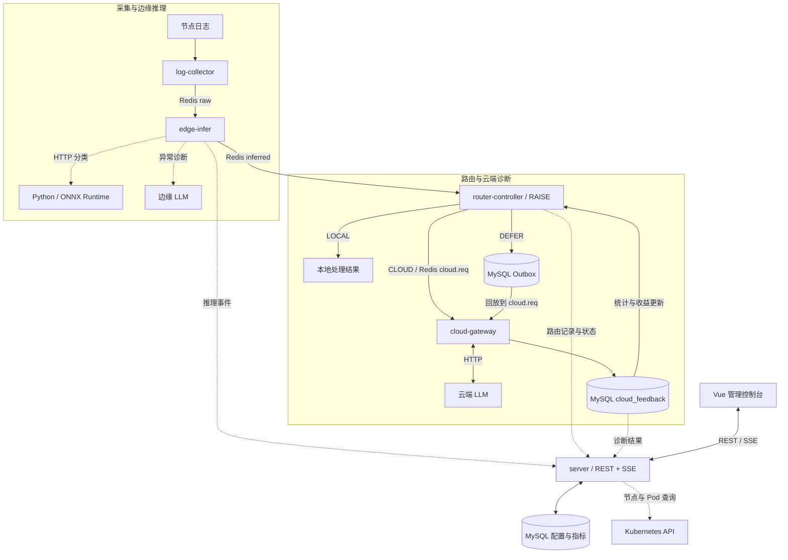

# CoTriage-Nova

**面向日志异常诊断的云边协同 AIOps 系统**

CoTriage-Nova 将日志采集、边缘推理、动态路由和云端诊断串联起来：边缘侧通过规则、模板与轻量分类器完成初筛，RAISE 路由器结合事件风险、模型不确定性、预算和网络状态，决定本地处理、云端诊断或延期处理。诊断结果、路由依据和运行状态通过 Web 控制台统一展示。

系统由 **5 个独立 Java 服务 + Vue 管理前端 + Python 模型服务**组成，适用于设备日志监测、基础设施异常分析和云边协同诊断场景。

[核心功能](#核心功能) · [系统架构](#系统架构) · [技术栈](#技术栈) · [构建与验证](#构建与验证) · [部署方法](#部署方法) · [工程文档](#工程文档)

## 核心功能

| 能力 | 实现内容 |
| --- | --- |
| 节点日志采集 | 跟随日志文件的新增内容，关联 Kubernetes 节点与设备信息，生成统一事件并写入 Redis Streams。 |
| 分层边缘推理 | 按规则、静态模板、Redis 模板缓存、HTTP 分类器和边缘 LLM 逐级处理，输出异常类别、严重度、置信度、证据与建议。 |
| RAISE 动态路由 | 综合风险、不确定性、模板新颖度、历史边云分歧、预期收益，以及预算、队列和网络压力，选择 `LOCAL / CLOUD / DEFER`。 |
| 云端上下文诊断 | 聚合相关日志、脱敏后调用 OpenAI-compatible 模型接口，生成结构化根因、处置建议与诊断反馈。 |
| 延期任务与反馈 | 使用 MySQL Outbox 保存延期请求，支持锁定、回放、退避和重试次数管理；云端反馈用于更新路由统计与收益模型。 |
| 实时管理控制台 | 展示设备、异常分布、事件流、路由记录和运行指标；管理规则、模板、分类器及模型提供方，支持配置发布、激活和 SSE 实时更新。 |

边缘推理消费者提供 Pending 消息接管、失败重试与 DLQ；各服务通过 Redis 消息流和 MySQL 记录协作。具体失败处理和兼容行为见[工程说明](migration/README.md)。

## 系统架构



### 三种路由动作

| 动作 | 处理方式 |
| --- | --- |
| `LOCAL` | 使用边缘侧结果，记录路由决策。 |
| `CLOUD` | 将请求发送到云端诊断队列，由网关聚合上下文并调用模型。 |
| `DEFER` | 将请求写入 Outbox，由回放任务后续发送到云端请求队列。 |

RAISE 输出动作的同时记录分数、阈值、特征、成本、压力项和原因，便于在控制台追踪每次决策。Outbox 的 `SENT` 表示请求已发布到 Redis，云端诊断结果由独立反馈记录表示。

### 服务与目录

| 目录 | 职责 |
| --- | --- |
| `log-collector/` | 日志采集器，以 DaemonSet 部署到工作节点。 |
| `edge-infer/` | 边缘推理编排、规则与模板、模型调用、配置刷新。 |
| `router-controller/` | RAISE、预算与健康状态、Outbox、反馈处理及快照。 |
| `cloud-gateway/` | 上下文聚合、脱敏、云模型适配和诊断反馈。 |
| `server/` | 管理与查询 API、SSE、Kubernetes 查询、配置生命周期。 |
| `cotriage-common/` | 配置解析与序列化工具、连接适配和表结构初始化。 |
| `web/` | Vue 管理前端。 |
| `dataset/` | 数据预处理、模型训练、ONNX 导出及 HTTP 分类服务。 |
| `charts/` | Kubernetes 资源清单。 |
| `migration-tests/` | 五服务进程联调与数据库兼容测试。 |

## 技术栈

| 层次 | 技术 |
| --- | --- |
| 核心后端 | Java 25、Spring Boot 4.1.1、Spring MVC、REST、SSE |
| 构建 | Maven 多模块、Maven Wrapper 3.9.16 |
| 数据访问 | Spring JDBC、HikariCP、MySQL |
| 消息与缓存 | Redis Streams、Lettuce、消费者组、模板缓存 |
| 规则与序列化 | RE2/J、Jackson |
| Web 前端 | Vue 3、TypeScript、Vite、Ant Design Vue、ECharts |
| 模型服务 | Python 3.11、ONNX Runtime、Transformers；训练与导出使用 PyTorch |
| 模型接入 | HTTP 分类接口、OpenAI-compatible Chat API |
| 部署与验证 | Docker、Kubernetes、JUnit、Testcontainers |

MySQL 8.4 和 Redis 7.4 是仓库隔离集成测试使用的版本；前端 Docker 构建使用 Node.js 22。

## 构建与验证

### 环境准备

- **JDK 25**：编译和运行 Java 服务。
- **Node.js 22 与 npm**：构建或启动前端。
- **Docker 引擎**：构建镜像、运行 Testcontainers 集成测试；镜像启动检查另需 Docker Compose。
- **Python 3.11 环境**：运行模型服务或训练工具时使用。
- **kubectl、Bash、PowerShell 7（`pwsh`）**：分别用于集群操作、开发/镜像脚本和清单渲染。

克隆项目后，以下构建命令均从仓库根目录执行：

```bash
git clone https://github.com/js6288/CoTriage-Nova.git
cd CoTriage-Nova
./mvnw -DskipTests package
npm --prefix web ci
npm --prefix web run build
```

Windows PowerShell 中，将 `./mvnw` 替换为 `.\mvnw.cmd`。每个 Java 服务生成独立可执行包：

```text
<service>/target/<service>-0.1.0-SNAPSHOT.jar
```

### 运行测试

```bash
./mvnw verify
```

测试会创建隔离的 MySQL/Redis 容器，并使用确定性的模型与 Kubernetes HTTP 测试服务。端到端测试覆盖五个 Java 进程、47 个 HTTP 路由、两条 SSE，以及三种路由动作、Outbox 回放和云反馈。

[2026-09-12 的验收记录](migration/validation-report.md)包含 120 项通过的测试、五个镜像的启动检查及 Kubernetes 清单验证结果。

## 部署方法

### 方式一：Kubernetes 部署

五个 Java 服务独立部署；前端和 ONNX 分类器分别构建镜像。清单默认使用 `cotriage` 命名空间。

**1. 准备基础设施与配置**

| 项目 | 要求 |
| --- | --- |
| 命名空间 | 创建 `cotriage`。 |
| MySQL | 准备 `cotriage` 数据库和有建表权限的 `cotriage` 用户；通过 `mysql-secret` 提供 `MYSQL_USER`、`MYSQL_PASSWORD`、`MYSQL_ROOT_PASSWORD`。 |
| Redis | 提供可供应用访问的 `redis:6379` 服务。 |
| 配置下发令牌 | 创建 `cloud-gateway-config-auth` Secret，包含 `token`；server 与 cloud-gateway 使用同一值。 |
| 镜像拉取 | 私有仓库按清单配置 `docker-registry-secret`，采集器使用 `regcred`；公开镜像可移除相应 `imagePullSecrets`。 |
| 节点与存储 | MySQL 清单需要可用的 PVC 存储；采集器默认运行在非 control-plane 节点，挂载宿主机 `/var/log/cotriage`。 |
| 日志输入 | 将新增日志持续写入工作节点的 `/var/log/cotriage/input/current.log`，或调整采集路径及挂载。 |
| 模型文件 | 使用 ONNX 分类器时，先准备下文说明的模型部署包。 |

仓库提供 [MySQL](charts/mysql/) 和 [Redis](charts/redis/) 资源模板。先按环境调整基础镜像与 Secret，再部署：

```bash
kubectl create namespace cotriage
# 在此命名空间准备上述 Secret 后执行
kubectl apply -f charts/mysql/ -f charts/redis/
```

MySQL 模板未设置 `MYSQL_DATABASE`。服务就绪后，使用数据库管理员身份创建并授权：

```sql
CREATE DATABASE IF NOT EXISTS cotriage CHARACTER SET utf8mb4;
GRANT ALL PRIVILEGES ON cotriage.* TO 'cotriage'@'%';
```

**2. 构建并推送应用镜像**

将 `IMAGE_PREFIX` 替换为自己的镜像仓库地址。以下示例使用 Bash：

```bash
export IMAGE_PREFIX=ghcr.io/your-account/cotriage-nova
export IMAGE_TAG=java25

./script/build-java-images.sh
for service in log-collector edge-infer router-controller cloud-gateway server; do
  docker push "$IMAGE_PREFIX/$service:$IMAGE_TAG"
done

docker build -f web/Dockerfile -t "$IMAGE_PREFIX/web:$IMAGE_TAG" web
docker push "$IMAGE_PREFIX/web:$IMAGE_TAG"
```

Java 镜像脚本只负责构建，默认标签为 `cotriage-nova/<service>:java25`；所有 Java Dockerfile 的构建上下文都是仓库根目录。

**3. 准备 ONNX 分类器**

分类服务需要 `model.onnx`、`tokenizer/` 和 `deployment.json`，模型权重需自行训练或准备。训练与导出入口为 [train_bgl_classifier.py](dataset/model-training/train_bgl_classifier.py) 和 [export_onnx.py](dataset/model-training/export_onnx.py)。

将部署包放入 `dataset/model-training/outputs/bgl-minilm/onnx/` 后构建：

```bash
docker build -f dataset/model-training/Dockerfile \
  -t "$IMAGE_PREFIX/onnx-classifier:$IMAGE_TAG" dataset/model-training
docker push "$IMAGE_PREFIX/onnx-classifier:$IMAGE_TAG"
```

也可在已准备依赖的 Python 环境中独立启动：

```bash
python -m pip install -r dataset/model-training/requirements-serve.txt
python dataset/model-training/serve_onnx.py \
  --onnx-dir dataset/model-training/outputs/bgl-minilm/onnx \
  --host 127.0.0.1 --port 18080
```

分类器提供 `GET /healthz` 和 `POST /predict`，输出 `NON_ALERT / ALERT`；根因诊断由后续边缘 LLM 或云端模型完成。

**4. 部署服务并访问控制台**

```bash
mkdir -p .runtime/deploy
pwsh -File script/render-java-manifests.ps1 \
  -ImagePrefix "$IMAGE_PREFIX" -ImageTag "$IMAGE_TAG" \
  -OutputPath .runtime/deploy/java-services.yaml

kubectl apply -f charts/log-collector/rbac.yaml
kubectl apply -f .runtime/deploy/java-services.yaml
```

渲染脚本只生成五个 Java 服务及 server 的 Service/RBAC。将 `charts/web/deployment.yaml` 和 `charts/onnx-classifier/deployment.yaml` 中的 `image` 分别改为刚推送的前端与分类器镜像，再执行：

```bash
kubectl apply -f charts/onnx-classifier/ -f charts/web/
kubectl -n cotriage get deployments,daemonsets,pods
kubectl -n cotriage rollout status deployment/server
kubectl -n cotriage port-forward service/web 8088:80
```

浏览器访问 **http://127.0.0.1:8088**。前端 Nginx 将 `/api/` 转发到 `server:8080`，并关闭代理缓冲以支持 SSE。

在控制台中配置并激活分类器、边缘模型和云模型提供方；云端诊断需要一个已激活且可访问的云模型提供方。边缘 LLM 是可选的异常诊断路径。

### 方式二：已有开发集群 + 本地应用进程

已有 MySQL、Redis、ONNX classifier 和采集器的开发集群时，可使用根目录启动脚本完成端口转发，并在本机运行 Java 服务与 Vite 前端。需要 `kubectl`、`nc`、`seq`、Bash、JDK 25 和 npm。

> **开发环境提示：此脚本会执行 Redis `FLUSHDB`，并重启集群中的采集器 DaemonSet。请使用专门的开发环境。**

```bash
npm --prefix web ci
export KUBECONFIG_PATH=/absolute/path/to/kubeconfig
export MYSQL_DSN='cotriage:<password>@tcp(127.0.0.1:3306)/cotriage?charset=utf8mb4&parseTime=true&loc=UTC'
export EDGE_LLM_URL=http://127.0.0.1:18081/v1/chat/completions
./start-cotriage.sh
```

将 `EDGE_LLM_URL` 替换为自己的边缘模型地址。若集群启用了配置下发令牌，同时设置与 Secret 一致的 `CLOUD_GATEWAY_CONFIG_TOKEN`。

默认前端地址为 **http://127.0.0.1:5173**，管理 API 为 **http://127.0.0.1:8080/api/v1**。日志写入 `.runtime/logs/`，按 Ctrl-C 停止脚本启动的本地进程与端口转发。

可选参数：`--no-cloud` 跳过云网关，`--no-web` 跳过前端，`--with-avatar` 启用额外配置的数字人演示。完整参数可运行 `./start-cotriage.sh --help` 查看。

### 常用配置

| 变量 | 用途 / 示例 |
| --- | --- |
| `REDIS_ADDR` | Redis 地址，例如 `redis:6379`。 |
| `MYSQL_DSN` | 数据库连接串，格式为 `user:password@tcp(host:3306)/cotriage?charset=utf8mb4&parseTime=true&loc=UTC`。 |
| `KUBECONFIG` | 单独运行 Java 采集器或 server 时使用的 kubeconfig；在 Pod 中使用集群内身份。 |
| `KUBECONFIG_PATH` | 根目录 Bash 开发启动脚本使用的 kubeconfig 路径。 |
| `CLASSIFIER_URL` | 分类器完整地址，例如 `http://onnx-classifier:18080/predict`。 |
| `LLM_URL` | 直接启动 edge-infer 时的边缘模型地址；开发启动脚本通过 `EDGE_LLM_URL` 传入。 |
| `EDGE_CONFIG_URL` | 边缘配置拉取地址，例如 `http://server:8080/api/v1/edge-config`。 |
| `SERVER_BASE_URL` | 云网关读取配置的 server 地址，例如 `http://server:8080`。 |
| `CLOUD_GATEWAY_CONFIG_TOKEN` | 云配置下发的 Bearer Token，server 与 cloud-gateway 保持一致。 |
| `RAISE_THRESHOLD_BASE` | RAISE 基础阈值，默认 `0.55`。 |
| `OUTBOX_REPLAYER_ENABLED` | 是否启用 Outbox 回放，默认 `1`。 |

时间配置接受 `200ms`、`2s`、`10m` 等格式。Java 清单默认设置 `-Xms64m -Xmx256m`，容器内存 request 为 256 MiB、limit 为 512 MiB，可按实际负载调整。

## 工程文档

- [完整验收记录](migration/validation-report.md)：测试、镜像启动、资源清单与文件核对结果。
- [兼容行为与已知限制](migration/README.md)：消息、数据、重试及失败处理的具体语义。
- [五服务端到端测试](migration-tests/src/test/java/io/cotriage/nova/verification/EndToEndIT.java)：HTTP、SSE、路由和反馈链路。
- [数据预处理](dataset/README.md)、[模型训练](dataset/model-training/train_bgl_classifier.py)与[ONNX 导出](dataset/model-training/export_onnx.py)。
- [设计资料](design_doc/)与[项目展示材料](submission/)。

`direct-mode/`、`backend-mode/`、`platform-integrations/` 为可选数字人及 SDK 集成示例；`cotrige-archive/` 保存历史实现。当前核心系统由上述五个 Java 服务、Vue 前端和 Python 模型服务组成。
