# CoTriage：面向工业多设备日志的云边协同智能故障感知与决策系统

> 挑战杯作品报告<br>
> 对应题目：XH-202606 面向云边协同场景的分布式人工智能感知与决策关键技术研究<br>
> 版本：V0.3（2026 年 8 月）

## 摘要

工业现场的日志诊断本质上不是单一分类问题，而是在连续事件流、有限边缘算力、不稳定网络和受限云端预算之间分配分析能力的问题。纯规则方案难以应对模板漂移与未知故障，全量上云又会把现场响应绑定于网络、费用和隐私边界。CoTriage 据此提出一种面向工业多设备日志的事件级云边协同范式：不预先固定“边缘”或“云端”为唯一执行位置，而是依据每条事件的风险、认知不确定性与实时系统状态，动态决定分析深度和处理时机。

系统首先构建统一事件语义，将规则、可审计模板知识、MiniLM ONNX 轻量分类器和边缘小语言模型组织为异构分层推理链。确定性知识在低成本路径提前收敛，开放性异常逐级获得更强语义能力；各层在同一输出契约中保留证据、置信度、模型与规则版本，使速度、能力和可解释性不再相互割裂。规则、模板与模型配置可热更新并原子切换，失败时保留上一可用快照，从而将模型推理能力转化为可治理的现场基础设施，而非一次性的算法演示。

作品的核心创新是风险感知、不确定性校准、策略意图约束的自适应云边路由机制 RAISE。该机制将“事件是否值得上云”与“当前是否具备发送条件”分离建模：前者联合严重度、校准不确定性、模板新颖度、历史边云分歧、跨设备影响与推理路径风险评估云端增益，后者综合网络健康、队列压力、调用预算、限流和隐私策略形成动态门槛，并输出 `LOCAL`、`CLOUD`、`DEFER` 三类可解释决策。由此，高频确定性事件可在边缘闭环，高价值事件获得按需深诊；当云链路受限时，本地判断持续运行，延期任务则由持久化 Outbox 按风险优先级重放，避免弱网将“暂时不可发送”演化为“永久失去诊断机会”。

云端并非简单复判单条日志，而是在 Token 预算内聚合时间邻近、同源、同模板和跨设备关联事件，经脱敏后生成根因候选、处置建议与结构化解释。诊断结果通过幂等边界持久化，并被转换为纠错、可执行信息增量和高风险确认等反馈信号，更新模板统计与在线增益状态；统一事件标识、状态快照和全链路观测则使每次推理、路由、延期和诊断均可追溯。系统由此形成“边缘感知—价值路由—云端增益—反馈演进”的工程闭环。

CoTriage 的价值不在于叠加边缘模型与云端大模型，而在于建立一套可度量、可约束、可演进的智能能力调度机制：把云端能力集中用于少量真正困难或高风险的事件，把实时性与基本业务连续性留在现场，并以稳定契约支持日志来源、模型 Provider、节点规模和应用场景的扩展。该方案为工业生产服务、数据中心及分布式基础设施提供了兼顾实时响应、诊断深度、资源效率与弱网韧性的智能运维路径。

**关键词：** 云边协同；工业日志；分层推理；RAISE 动态路由；不确定性校准；弱网韧性；根因诊断

## 1. 项目痛点与赛事目标

### 1.1 从日志“看得见”到故障“处置得了”

在工业制造、能源设施、数据中心和智慧城市等场景中，设备、操作系统、中间件和业务服务会同时输出运行日志。日志量大、格式异构、到达连续，故障又可能在多台设备之间传播。仅仅把日志集中展示，并不能解决现场运维的核心问题：系统还要及时识别风险，给出可追踪的判断，并在必要时组织更强的分析能力。

实际系统通常同时面对四组矛盾：

1. **响应速度与分析深度。** 已知告警需要快速触发，复杂故障却需要跨设备、跨时间窗口的上下文推理。
2. **局部观测与全局关联。** 单个边缘节点看到的是局部日志，集群级问题往往要结合多个来源才能区分共同根因和连锁反应。
3. **智能能力与资源约束。** 边缘环境的算力和内存有限，云端模型能力更强，但全量上传会增加时延、通信与费用。
4. **连续业务与网络波动。** 云端链路可能发生高时延、限流或短时中断，现场判断不能因此整体停摆。

### 1.2 常见处理方式为什么不够

- **纯规则处理**响应快、解释直接，但依赖人工经验，面对未知模板和复杂语义时覆盖有限。
- **所有日志集中处理**便于聚合上下文，却会把现场响应绑定到网络和云端服务，并扩大数据上传范围。
- **固定级联处理**通常只依据单一置信度阈值升级，难以随风险、预算、队列和网络状态变化。
- **简单缓存补传**能够保存未发送请求，但若只按先入先出处理，链路恢复后未必优先处理真正高风险的事件。

CoTriage 因而把问题拆成两个层次：先让边缘侧为每条日志形成可用初判，再判断这条事件是否值得、是否适合在当前时刻调用云端。第二个问题不是固定开关，而是随事件价值和系统状态变化的在线决策。

### 1.3 赛事目标转化为设计约束

赛题从技术效果、方案完整性、系统稳定性与一致性、创新性和应用价值等方面评价作品，并给出若干量化目标。下表列出这些目标在 CoTriage 中对应的设计关注点；表中的目标属于赛事要求，不代表本系统的当前运行结论。

| 赛事关注方向 | 赛题目标或评价重点 | CoTriage 的设计对应 |
| --- | --- | --- |
| 边缘能力 | 轻量模型能力保持、边缘推理资源约束 | 规则/模板早停、MiniLM ONNX、边缘小语言模型和显式降级 |
| 实时性 | TTFT 改善、端到端平均时延等 | 就近采集、边缘快速判断、异步云端诊断、分阶段计时 |
| 弱网连续性 | 网络波动期间保持基本业务功能 | 本地结果不依赖云端完成，`DEFER + Outbox` 保存延期请求 |
| 完整性与扩展性 | 完整架构、至少两类差异场景、节点和应用扩展 | 组件解耦、统一事件、独立部署、模型与采集适配可替换 |
| 稳定性与一致性 | 多节点冲突控制与冲突处理 | 幂等、重试、关联上下文、边云反馈和状态追踪 |
| 资源与通信 | 减少不必要上传与云端消耗 | 事件级路由、上下文裁剪、预算感知和调用统计 |

### 1.4 作品目标与报告主线

围绕上述约束，CoTriage 的目标是形成一条可运行、可观察、可治理的日志分诊链路：

1. 多节点日志在边缘域就近采集并统一事件化；
2. 常见事件由低成本方法优先处理，困难事件逐级获得更强的语义能力；
3. RAISE 根据事件价值与系统状态选择本地、云端或延期处理；
4. 云端围绕高价值事件聚合上下文，生成根因、建议和结构化解释；
5. 规则、模板、边缘模型和云端 Provider 可以在线配置，运行状态能够集中展示；
6. 网络异常或组件失败时，系统按明确的降级、重试和死信边界处理。

后续章节从场景和需求出发，依次说明总体架构、多节点采集、边缘推理、动态路由、云端诊断与工程实现，最后结合运行看板解释赛事指标的观察口径，并总结作品的创新、价值和现阶段边界。

## 2. 典型应用场景与用户需求

### 2.1 场景一：工业设备与生产服务监测

生产设备、操作系统和业务服务持续产生系统日志、应用日志和告警。边缘集群部署在车间或厂区近端：明确的风险模式优先由规则或模板快速识别，常见语义由轻量模型处理，新模板、低置信或疑似扩散的异常再由 RAISE 判断是否进入云端。现场人员首先获得边缘判断，随后可按需查看云端生成的根因和处置建议。

这一场景关注的不是单一模型得分，而是故障发现与现场处置能否连续衔接：日志是否及时进入系统、已知问题是否快速识别、复杂问题是否获得更深入解释，以及网络波动时本地判断是否仍能继续产生。

### 2.2 场景二：分布式基础设施监测

ZooKeeper、Web 服务和计算集群等系统具有多节点、关联调用和模板漂移特征。同一故障可能先在依赖服务中出现，再以超时、重试或连接失败的形式扩散到其他节点。边缘侧负责节点级快速识别，云端则结合多个节点的时间邻近事件，帮助区分单点故障、网络分区、依赖服务异常和集群级问题。

两类场景的设备和日志格式不同，却共享同一条业务抽象：日志在产生位置附近被采集和初筛，只有风险、复杂度或不确定性超过边缘处理能力的事件才调动云端。这种统一事件抽象使系统不依赖某一种设备协议，也使采集适配、知识库和模型能够按场景替换。

### 2.3 角色与典型任务

| 角色 | 典型任务 | 主要关注点 |
| --- | --- | --- |
| 现场运维人员 | 查看实时事件、异常态势、根因和处置建议 | 响应及时、解释清楚、弱网可用 |
| 系统管理员 | 管理设备、规则、模板、模型和 Provider | 配置版本、启停状态、密钥安全和回滚 |
| 算法与平台人员 | 更新边缘模型、调整路由策略、核对运行指标 | 接口稳定、版本可追踪、统计口径一致 |
| 评审与验收人员 | 沿主链路观察系统功能和运行状态 | 架构完整、功能连贯、边界明确 |

### 2.4 多设备接入与功能需求

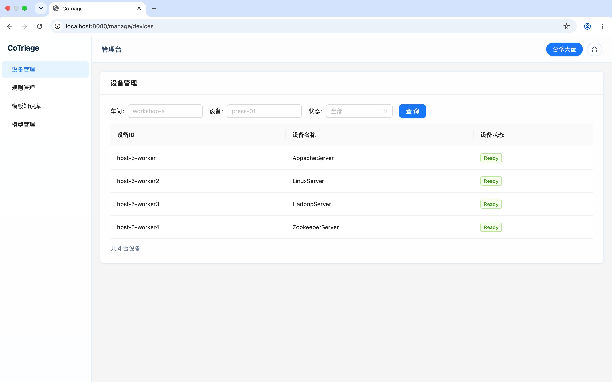

*图 2-1 多类设备和节点在同一管理界面中登记与观察。该界面反映截图时的设备状态，不用于推断系统的扩展上限。*

系统面向的核心功能包括：

- 多节点日志就近采集，并转换为带有稳定标识和来源信息的统一事件；
- 规则、模板、轻量分类器和边缘小语言模型分层推理；
- 联合网络、预算、风险和不确定性执行 `LOCAL/CLOUD/DEFER` 路由；
- 通过 Outbox 保存延期请求，按优先级和到期时间重试，超过上限后进入死信处理；
- 聚合相关上下文，对主日志和关联原始日志脱敏后调用云端模型；
- 将云端结果持久化，并更新可供路由参考的反馈统计；
- 通过 REST/SSE 提供事件、路由、Outbox、规则和模型的管理与查询能力；
- 在 Web 端展示实时事件流、异常态势、路由状态、云端诊断和配置状态。

这些能力组成四个相互衔接的闭环：感知闭环把异构日志变成统一事件，决策闭环把边缘结果变成三动作路由，诊断闭环把选中的上下文变成结构化结论，工程闭环负责配置、追踪、重试和展示。四个闭环共享事件标识与版本信息，避免系统退化为彼此割裂的模型演示。

### 2.5 非功能需求

- **实时性：** 边缘快速路径不等待云端完成后才产生现场结果。
- **可靠性：** 当前处理阶段完成后再确认消息，关键写入具备幂等边界和失败重试。
- **弱网自治：** 云端不可达时边缘推理继续运行，有上云价值的事件持久化等待后续处理。
- **可解释性：** 推理保留路径与版本，路由保留动作、原因、分数、门槛和系统状态。
- **可扩展性：** 采集、推理、路由、网关与管理端可以独立部署和扩容。
- **安全性：** 原始日志上云前进行脱敏，运维硬策略可以阻止指定来源或类别上云。
- **可维护性：** 配置更新失败时继续使用上一份有效配置，运行异常能够通过健康、队列与死信状态定位。

这些要求决定系统在异常条件下“如何退化”。例如，网络中断时应保留边缘判断并持久化有价值的延期请求，而不是让整条链路停止；配置拉取失败时应继续使用上一版本，而不是加载半份配置。

## 3. 总体方案与系统架构

### 3.1 架构总览

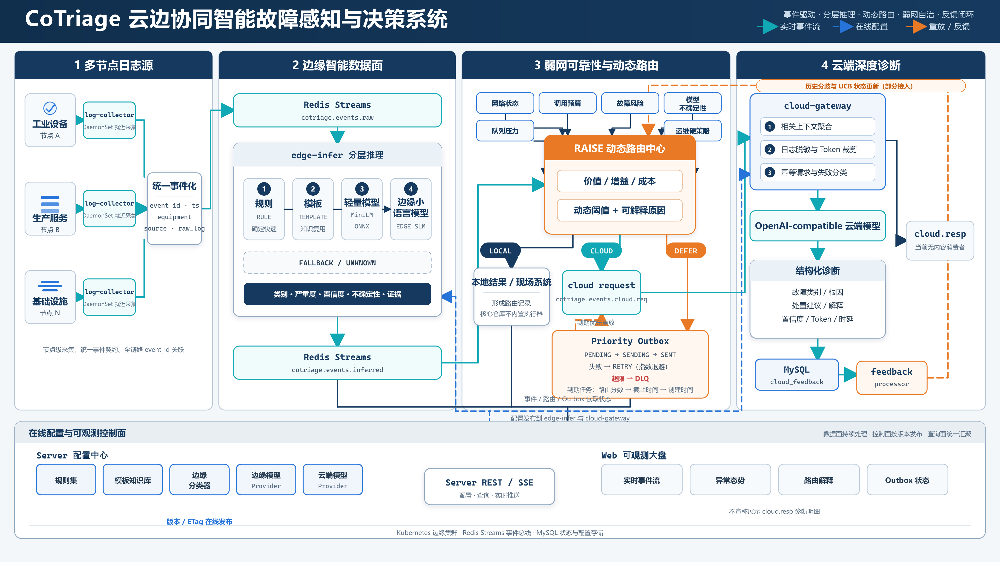

*图 3-1 CoTriage 系统架构。实线主链表示实时事件从采集、推理、路由到诊断的流动，回路线表示延期重放和反馈，控制面与观测面分别负责在线配置和运行解释。*

系统由六类核心组件围绕统一事件协作：端侧采集器、边缘推理服务、RAISE 路由控制器、云端诊断网关、Server 控制与查询面，以及 Web 管理端。边缘域可以是工厂、园区或站点近端的小型 Kubernetes 集群，也可以是开发演示环境中的本地进程组合；云端模型通过 OpenAI-compatible Provider 按需接入。

阅读架构图时，可以先沿实时事件流自左向右观察一条日志如何经过采集、推理、路由和云端诊断，再观察 Outbox 如何保存延期请求、反馈如何回到路由统计，最后查看规则和模型配置如何由管理中心下发。这样能够区分三类作用不同的通道：数据面负责持续处理事件，控制面负责改变运行行为，观测面负责解释系统状态。

### 3.2 组件职责

| 组件 | 核心职责 | 主要输入与输出 |
| --- | --- | --- |
| `log-collector` | 持续读取节点新增日志并统一事件化 | 日志文件 → 原始事件流 |
| `edge-infer` | 规则、模板、轻量模型和边缘小语言模型分层推理 | 原始事件 → 边缘推理事件 |
| `router-controller` | RAISE 决策、Outbox、反馈统计与状态快照 | 推理事件 → 路由结果或云端请求 |
| `cloud-gateway` | 上下文聚合、原始日志脱敏、结构化云端诊断 | 云端请求 → 诊断结果与反馈记录 |
| `server` | REST/SSE 控制面与查询面 | Redis/MySQL/Kubernetes → API |
| `web` | 实时驾驶舱、异常诊断、路由观察和配置管理 | REST/SSE → 浏览器界面 |

此外，`onnx-classifier` 以独立 HTTP 服务封装 MiniLM ONNX 推理。独立部署使模型服务可以单独更新和扩容，同时保持 Go 主链路的接口稳定。

### 3.3 数据面、控制面与观测面

**数据面**承载实时日志处理。采集、推理、路由和诊断通过 Redis Streams 与数据库状态交接，管理页面短暂不可用不会停止事件处理。

**控制面**由 Server 汇总活动规则集、模板集、分类器、边缘 Provider 和云端 Provider 配置。边缘推理服务通过 ETag 轮询配置：新内容先完成解析与校验，失败时继续使用上一份有效配置。知识与模型分别加锁更新，但当前不是跨两个子系统的整体原子切换。

**观测面**通过 REST 加载当前快照，通过 SSE 接收新增事件。事件、推理路径、路由原因、系统压力和 Outbox 状态被组织到同一管理端，帮助使用者同时回答“发生了什么”和“系统为什么这样处理”。

三者分离的价值在于：数据面优先保持连续，控制面可以安全演进，观测面则把内部机制转化为现场人员能够理解的运行状态。

### 3.4 统一事件与消息拓扑

系统使用 `event_id` 串联采集、推理、路由和云端诊断，并使用 `idempotency_key` 降低重复消费造成的重复写入和重复调用风险。“统一事件”不改变原始日志含义，而是在原文之外补充来源、设备、时间、处理阶段、推理结果和版本等公共字段。组件因此只需理解稳定的事件契约，不必了解彼此的内部实现。

| Stream | 主要写入方 | 主要消费方 | 用途 |
| --- | --- | --- | --- |
| `cotriage.events.raw` | log-collector | edge-infer | 原始日志事件 |
| `cotriage.events.inferred` | edge-infer | router-controller | 边缘推理结果 |
| `cotriage.events.routed` | router-controller | server/web | 路由动作与解释 |
| `cotriage.events.cloud.req` | router-controller/replayer | cloud-gateway | 云端诊断请求 |
| `cotriage.events.cloud.resp` | cloud-gateway | 状态统计与后续接入 | 云端诊断结果通知 |
| `cotriage.events.dlq` | 各处理阶段 | 运维与管理面 | 不可恢复错误 |

### 3.5 事件生命周期

```text
CREATED → INFERRED → ROUTED ─┬─ LOCAL：保存并发布现场判断
                             ├─ CLOUD：立即进入云端请求流
                             └─ DEFER：写入 Outbox，等待再次发布

CLOUD_REQUESTED → CLOUD_PROCESSING → CLOUD_DONE
任一阶段的不可恢复错误 → DLQ
```

这是一条便于理解的概念主干，并非每种动作都遍历全部状态。`LOCAL` 事件由 Router 落库并发布路由判断；当前系统没有独立的现场告警执行器。`CLOUD` 事件立即进入云端请求流，`DEFER` 事件进入 MySQL `cloud_outbox`。延期请求的“已发布”与云端诊断的“已完成”是两个不同阶段，不能混为同一状态。

## 4. 多节点采集与统一事件化

### 4.1 日志就近采集

`log-collector` 可以按节点以 DaemonSet 方式运行。当前实现从目标文件末尾持续读取新增行，为每条非空日志生成新的 `event_id`，补充采集时间与设备信息后写入原始事件流。按节点部署使日志无需先集中到中心节点，也使新增工作节点能够随部署扩展。

当前采集器尚未实现时间窗口聚合，也没有覆盖日志轮转或 inode 切换。正式长期运行时，需要把轮转识别、断点保存和采集状态监控补入采集层；这不影响当前新增日志行进入主链路的功能展示，但决定生产环境下的连续采集可靠性。

### 4.2 从日志文本到可追踪事件

事件化的作用，是把“来自某台机器的一行文本”变成“可以被全系统一致处理的业务对象”。原始日志仍被保留，新增字段则回答它来自哪里、何时进入系统、由哪条推理路径处理、采用哪个配置版本，以及最终为何选择某个路由动作。

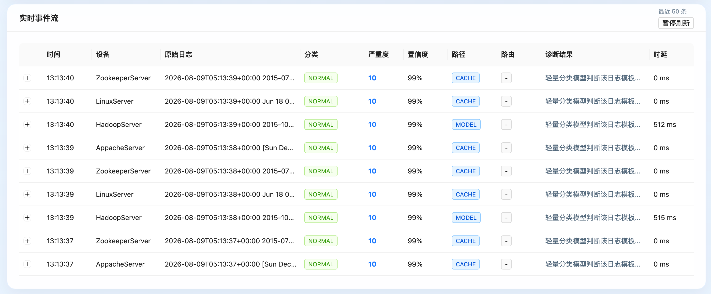

*图 4-1 多设备实时事件在同一事件流中展示。界面同时出现 CACHE 与 MODEL 推理路径、置信度、诊断摘要和单事件时延；单条记录的即时值不等同于统计窗口内的平均值或分位数。*

统一事件让不同日志格式能够进入相同后续流程。更换规则引擎、模型服务或展示端时，主链路仍可沿同一标识追踪；需要回放某次判断时，也能把采集记录、推理输出、路由状态和云端结果重新关联起来。

### 4.3 消息确认、重试与幂等

Redis Stream 可以理解为按序追加的消息日志；Consumer Group 让多个实例分担消费，显式 ACK 表示某条消息已经完成当前阶段。已投递但尚未确认的消息会记录在 Pending Entries List 中，只有具备接管机制，其他实例才能在原消费者失效后继续处理。

- `edge-infer` 已实现 Pending 自动接管、最大尝试次数和死信处理；
- `router-controller` 处理失败时保留未确认消息，但主 Worker 当前只读取新消息，尚未自动接管旧 Pending；
- `cloud-gateway` 对不可重试错误写入死信，对可重试错误保留 Pending，当前同样缺少自动接管路径；
- Outbox 对事件、请求和幂等键设置唯一约束，并实现超时锁回收、退避重试和死信处理；
- 云端反馈先幂等落库，再发布响应，避免通知失败时重复调用模型。

这些机制覆盖了消息确认、重复副作用控制和部分故障恢复，但 Pending 自动接管仍是 Router 与 Cloud Gateway 的工程补强点。报告因此区分“请求已保留”“请求已再次发布”和“诊断已经完成”三个状态，不用其中一个替代另外两个。

### 4.4 实时观察与事件追踪

推理结果记录 `inference_path`、模型版本和时延，路由结果记录动作、原因、分数、门槛、特征、成本与压力快照。Server 提供事件流、路由决策、Outbox 和状态查询接口，Web 通过 REST 获取快照并通过 SSE 接收增量事件。

这种设计让运维人员可以从趋势或异常卡片进入单条事件，再沿 `event_id` 回看其处理过程。系统展示的不只是最终标签，还包括路径和上下文，便于判断问题来自数据、模型、路由条件还是外部云端服务。

## 5. 边缘分层推理与在线配置

### 5.1 低成本方法优先、困难事件逐级升级

边缘推理遵循“低成本确定性处理优先，开放语义按需升级”的原则：

1. **RULE：** 对明确级别、关键词和运维规则进行快速判断；
2. **CACHE：** 使用已发布模板知识和 Redis 临时缓存复用历史结论；
3. **MODEL：** 调用 MiniLM ONNX 分类器完成常见日志的轻量语义判断；
4. **EDGE_LLM：** 对需要进一步解释的事件输出更细粒度的类别和建议。

`FALLBACK` 是显式降级支路，不是第五级推理。规则和模板未命中后，如果分类器未配置或调用失败，系统输出 `FALLBACK/UNKNOWN`；如果分类器已经成功给出 `MODEL` 结果，而边缘小语言模型未配置或失败，系统保留已有分类结果，并在证据字段中记录错误，不把结果改写为未知。

“分层”也不意味着每条日志都顺序运行全部方法。事件在足够确定的层级可以提前结束：规则适合稳定的运维知识，模板适合重复日志，轻量模型覆盖规则之外的常见语义，边缘小语言模型再处理需要更开放解释的事件。早停机制把算力留给更困难的输入，也让已知事件保留直接、可读的判断依据。

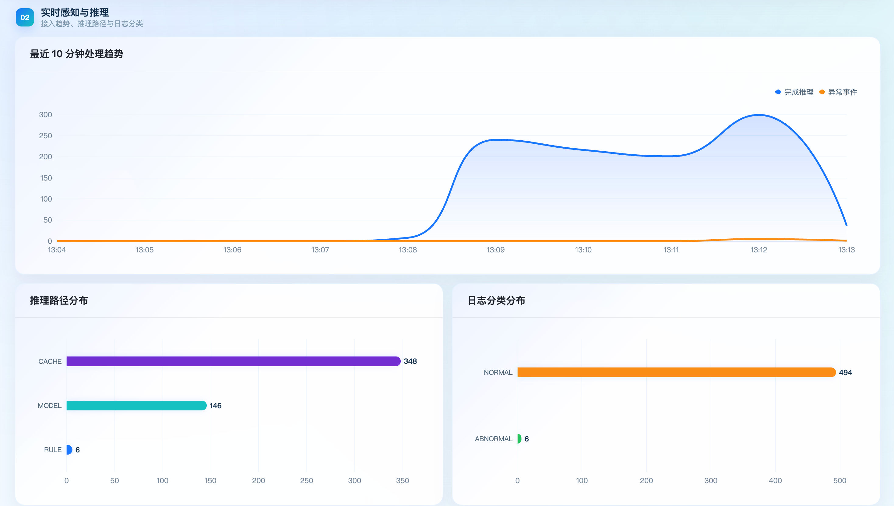

*图 5-1 运行窗口内的推理趋势、分类构成和 CACHE/MODEL/RULE 路径分布。图中数量用于展示系统运行构成，不替代跨窗口的统计分析。*

### 5.2 推理输出与路由输入

边缘侧为每条事件输出一组稳定字段：

```text
edge_pred, severity, confidence, uncertainty,
inference_path, evidence, model_version, latency_ms,
rule_version, template_set_version
```

这些字段既服务现场展示，也作为 RAISE 的输入。置信度描述模型对当前预测的把握，不确定性则作为路由所需的风险信号；二者不应直接等同为“判断正确的概率”。推理路径与版本字段回答“这个判断由谁、基于什么配置产生”，风险、不确定性和严重度字段回答“是否需要调用更强能力继续分析”。

### 5.3 异常态势与优先级

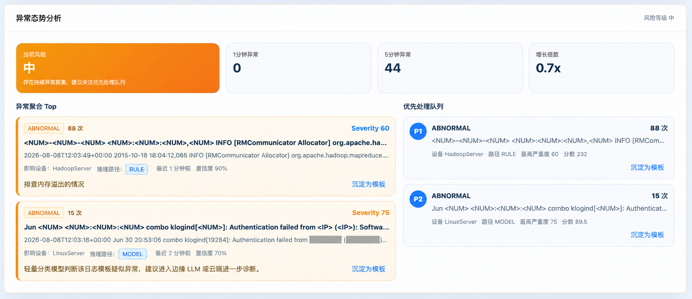

*图 5-2 历史日志样本在当前系统中的回放与分析。界面展示风险等级、异常聚合、优先队列、推理路径、严重度和置信度；它用于说明系统功能，不表示截图时间发生了真实生产故障。*

实时事件进入统一事件流后，管理端将分散记录组织为异常趋势、风险聚合和优先队列。现场人员因此不必在所有日志中逐行检索，而可以先查看高风险事件，再结合推理路径和诊断摘要下钻。这里的优先展示不改变底层事件内容，只是把日志按照其当前风险信息组织为更适合运维浏览的顺序。

### 5.4 规则与轻量模型在线治理

| 规则管理 | MiniLM 模型管理 |
| --- | --- |
| 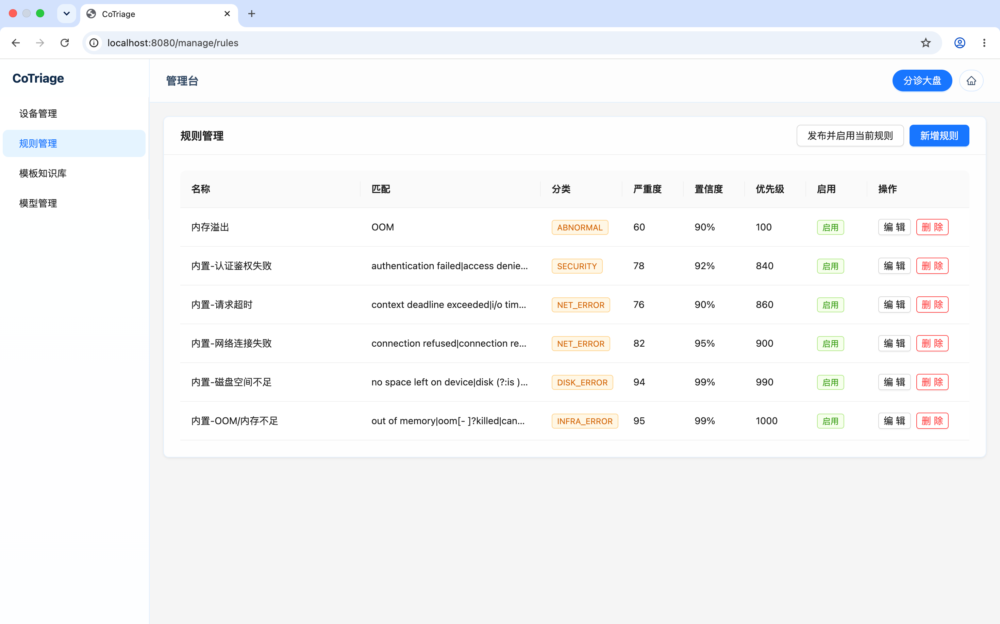 | 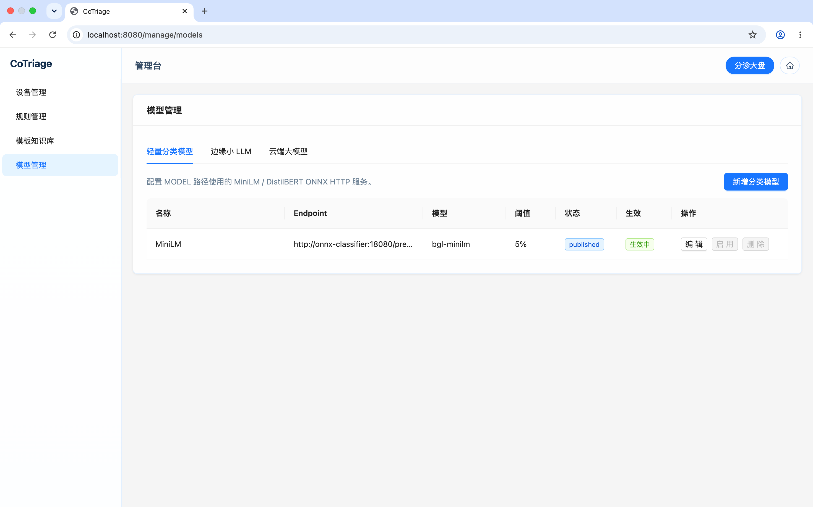 |

*图 5-3 规则与轻量模型可以在统一管理端维护、发布和查看生效状态。*

Server 聚合活动规则集、模板集、分类器和边缘 Provider 配置，`edge-infer` 使用 ETag 轮询更新。新配置先解析和校验，失败时继续使用上一份有效内容；分类器缺失或报错时进入显式降级，边缘小语言模型失败时保留已经产生的轻量模型结果。这样可以避免控制面短时异常直接中断实时推理。

### 5.5 当前模型边界

当前 MiniLM 分类器围绕公开 BGL 日志构造 `NON_ALERT/ALERT` 二分类任务，以归一化模板、组件和日志级别作为输入，导出 ONNX 后通过本地 HTTP 服务调用。这证明了轻量分类模型的接入、发布和在线推理能力，但二分类任务不能独自代表更广泛的数学、代码或自然语言推理能力。报告因此只把它描述为日志告警初筛模块，不把模型管理截图推导为通用能力评价。

## 6. RAISE 动态路由与弱网补偿

### 6.1 从边缘判断到资源决策

边缘推理回答“当前看出了什么”，RAISE 回答“下一步应该把有限资源用在哪里”。它将单条事件的分析价值与系统当时的承载条件分开考虑，再由软评分和硬策略共同形成最终动作。

RAISE 的输入可以归纳为四组：

- **事件风险：** 严重度、推理路径风险和影响设备范围；
- **认知不确定性：** 校准不确定性、模板新颖度和历史边云分歧；
- **系统条件：** 网络健康、云端队列、Outbox 压力、调用预算和预计时延；
- **治理意图：** 指定来源或类别的禁止上云、强制本地或强制云端策略。

事件分数描述“这条日志是否值得获得云端能力”，动态门槛描述“此刻系统允许什么程度的云端调用”。队列、预算或网络压力上升时门槛提高；近期缺少云端审计样本时，门槛可以适度降低，避免系统长期只依赖既有边缘结论。详细公式和算法流程见附录 A。

### 6.2 `LOCAL/CLOUD/DEFER` 三动作

```text
LOCAL：边缘结果足以支撑当前处理，或命中禁止上云/强制本地策略
CLOUD：事件值得上云，且云端健康、限流和预算允许立即发送
DEFER：事件仍有上云价值，但当前网络、限流或预算条件不适合发送
```

三种动作把两个容易混淆的问题分开：事件有没有进一步分析的价值，以及现在能不能发送。高风险事件在网络正常时可以选择 `CLOUD`，同一事件在链路受限时则可以进入 `DEFER`，同时保留已经生成的边缘判断。`deny-cloud`、`force-local`、`force-cloud` 等运维策略优先于学习分数，保证动态优化不会突破隐私和生产治理边界。

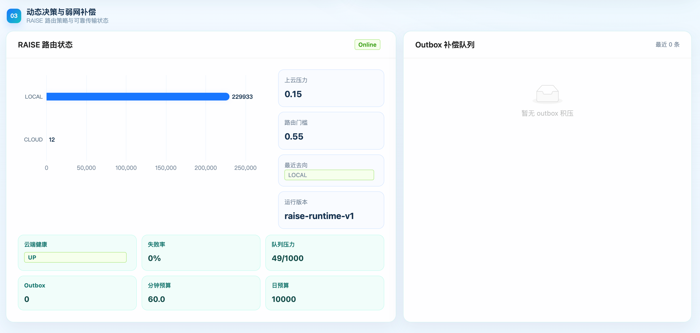

*图 6-1 RAISE 路由与可靠传输状态总览。页面集中展示路由累计、上云压力、当前门槛、最近路由、云端健康、队列、预算和 Outbox 状态；它是全局运行快照，不代替单事件分数和原因。*

图 6-1 说明路由器、云端状态采集和 Outbox 观察面已经进入同一界面。由于截图时最近路由为 `LOCAL`、Outbox 没有积压，画面不能单独证明 `DEFER` 触发或弱网恢复过程。系统对单次决策保存动作、原因、分数、门槛与状态快照，后续可以通过单事件详情解释具体路由。

### 6.3 Outbox 延期请求状态机

当 RAISE 选择 `DEFER` 时，事件写入 MySQL `cloud_outbox`。Outbox 是与实时云端请求流分离的持久化待办表，避免进程重启或网络波动时只把待发送事件留在内存中。

```text
PENDING / RETRY
       │ 到期并成功抢占
       ▼
    SENDING ──发布成功──→ SENT
       │
       └─发布失败──→ 退避重试 ──超过上限──→ DLQ
```

多实例通过条件更新抢占任务，超时锁可以回收，发布失败采用退避重试。到期任务按 `priority_score`、截止时间和创建时间排序，其中 `priority_score` 当前直接采用 RAISE 决策分数。这样的排序让更高价值、截止时间更近的请求优先于普通延期请求，而不是简单地按进入队列的先后处理。

### 6.4 弱网期间的业务分层

弱网保障分成三个层次：

1. **本地判断继续产生。** 边缘推理和路由主链不等待云端返回，现场仍能看到当前分类、风险和路径。
2. **有价值请求被持久化。** 暂时无法发送的云端请求进入 Outbox，进程重启或链路波动时不会只存在于内存。
3. **重试失败可追踪。** 请求在退避重试后仍无法处理时进入死信，交由运维查看和处置。

当前 replayer 到期后直接尝试发布，不先以云健康状态门控；发布成功时同时写入发送与完成时间，也没有独立的云端完成确认转换。因此，“请求已经重新进入消息流”不能直接等同于“云端诊断已经完成”。Router 与 Cloud Gateway 的 Pending 自动接管也需要继续完善。以上边界不影响本地分诊和延期保存的功能，但决定了端到端恢复语义需要如何补强。

## 7. 云端根因诊断与反馈闭环

### 7.1 围绕高价值事件聚合上下文

`cloud-gateway` 不把所有历史日志无边界拼接给模型，而是围绕主事件，从近期边缘事件中按时间、模板、来源、设备、类别和严重度选择相关上下文，再按事件数量和 Token 预算裁剪。时间邻近可以提示故障传播顺序，相同设备或模板可以提示重复模式，跨来源的高风险事件则可能反映共同依赖问题。

当前脱敏函数覆盖主事件和关联事件的 `raw_log`，处理 IP、邮箱、口令、Token、API Key、Secret 和长十六进制串。模板文本、设备、来源、证据和建议等提示字段尚未全部进入同一脱敏流程，正式生产使用需要扩展字段级脱敏、权限审计与回归检查。

### 7.2 结构化根因与处置建议

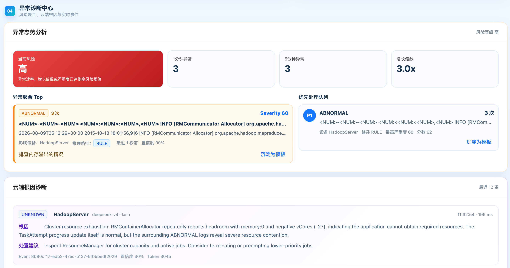

*图 7-1 异常诊断中心把异常趋势、风险聚合、优先事件、云端根因和实时事件组织在同一工作区。*

网关读取活动云端 Provider 配置，通过 OpenAI-compatible 接口请求结构化诊断。输出包括故障类别、根因、处置建议、解释、置信度、Token 用量和时延。解析层支持结构化 JSON、文本中的 JSON 提取和非结构化响应降级，并区分配置缺失、超时、限流和服务端错误。

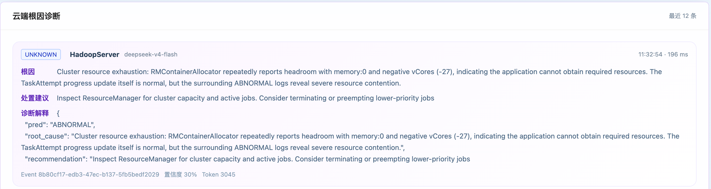

*图 7-2 云端诊断详情展示模型信息、根因候选、处置建议、解释、置信度、Token 用量和处理时延。页面顶部状态与解释文本可能对应边缘初判和云端复判等不同阶段，不能仅凭该画面计算分类效果。*

对运维人员而言，结构化输出把“异常”继续展开为三个可执行问题：可能原因是什么、下一步先检查什么、这个判断基于哪些上下文。系统仍保留原始事件和边缘判断，云端结果是补充和复核，不会抹去前序路径。

### 7.3 幂等写入与反馈更新

云端结果以事件和请求标识建立幂等边界。处理顺序是先把反馈写入 MySQL，再发布响应通知，最后确认请求消息。如果数据库已有结果而响应发布失败，重试时复用既有记录，避免再次调用模型。该顺序能够控制重复计费和结果漂移风险，但不能替代 Pending 自动接管。

路由器按模板维护云端调用、纠错和新增信息等统计，并保存可恢复的在线状态快照。当前反馈能够通过历史分歧和 UCB 探索间接影响后续决策；已经训练的 GainModel 预测值尚未直接接入 `Decide` 的预期收益，Cloud Gateway 与 Router 对 Reward 的计算语义也未完全统一。因此，现阶段更准确的表述是“具备反馈统计和在线探索接口的动态路由”，而不是已经完成端到端学习闭环。

### 7.4 云端 Provider 在线配置

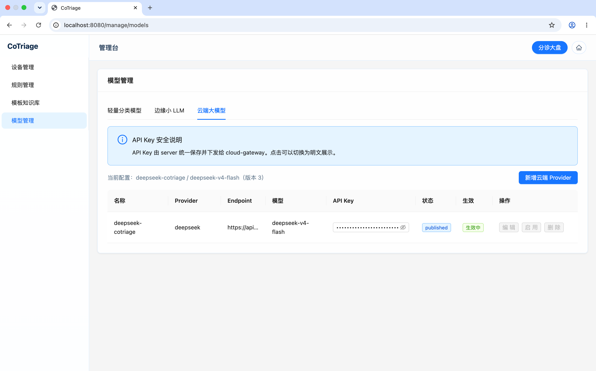

*图 7-3 云端模型、接口参数和发布状态由管理中心统一维护，密钥在界面中以掩码显示。*

Provider 与业务主链解耦后，云端模型可以在不修改事件协议的前提下替换。配置管理负责模型名称、接口地址、请求参数、启用与发布状态；数据面只消费当前活动配置。演示环境的配置能力不等同于生产级密钥托管，正式部署仍应使用专用 Secret 管理、最小权限和审计机制。

## 8. 工程实现、管理中心与演示路径

### 8.1 技术栈与部署单元

| 组件 | 主要技术 | 典型部署方式 |
| --- | --- | --- |
| log-collector | Go、Redis Streams | Kubernetes DaemonSet |
| edge-infer | Go、规则/模板/HTTP 模型 | Deployment 或本地进程 |
| onnx-classifier | Python、ONNX Runtime、MiniLM | Kubernetes Service |
| router-controller | Go、RAISE、MySQL、Redis | Deployment 或本地进程 |
| cloud-gateway | Go、OpenAI-compatible API | 独立进程或 Deployment |
| server | Go、Gin、MySQL、Redis、Kubernetes API | 独立进程或 Deployment |
| web | Vue 3、TypeScript、Ant Design Vue、ECharts | Web 服务 |

组件按照职责拆分后，采集吞吐、边缘推理、云端并发和管理访问可以分别扩展。Go 服务承担持续事件处理与控制接口，Python 服务封装 ONNX 推理，Web 端负责可视化；组件通过 Stream、HTTP 和数据库中的稳定契约协作，不共享进程内状态。

### 8.2 控制与查询接口

Server 已提供以下能力：

- 设备、实时事件、异常态势、路由摘要、路由决策、Outbox 和路由状态查询；
- 事件流和路由流的 SSE 订阅；
- 边缘规则、模板、规则集、模板集、分类器和边缘 Provider 管理；
- 云端 Provider 管理；
- 面向 `edge-infer` 与 `cloud-gateway` 的配置发布接口。

REST 适合加载历史快照和执行配置操作，SSE 适合把新增事件持续推送到浏览器。两者结合后，页面打开时可以恢复当前状态，运行过程中又能增量更新。接口路径由 Server 统一维护，避免各页面直接依赖底层 Stream 和表结构。

### 8.3 从应用首页进入完整系统

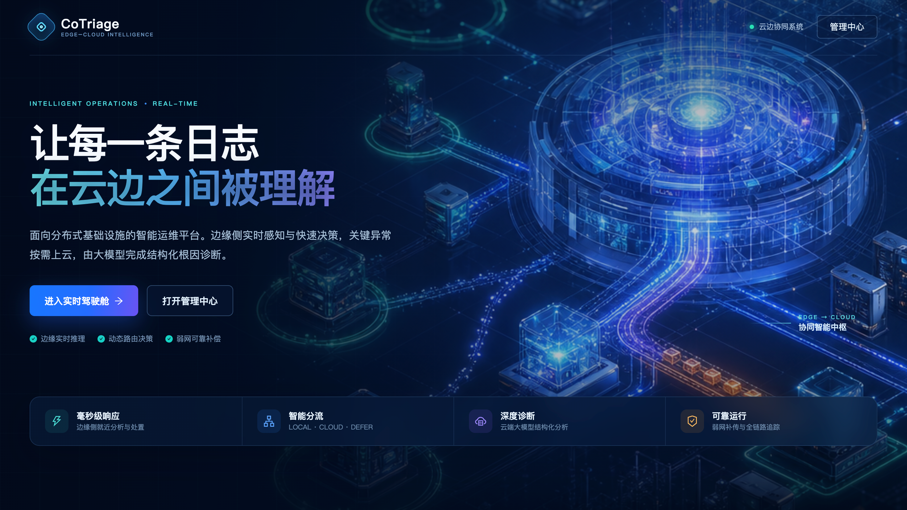

*图 8-1 CoTriage 应用入口汇总实时驾驶舱、管理中心与核心能力。首页中的产品文案用于导航和介绍，性能与可靠性仍以对应运行页面的统计口径理解。*

首页把系统定位和主要入口放在同一屏，适合评审先建立整体认识，再沿功能链路进入实时驾驶舱、异常诊断与配置管理。它解决的是“从哪里开始使用”，而不是替代系统运行状态证明。

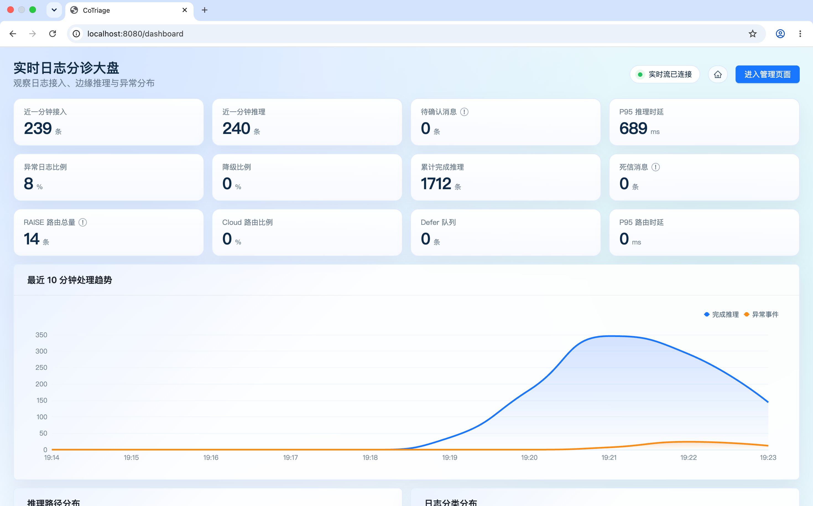

*图 8-2 实时驾驶舱集中展示事件接入、推理完成、时延、异常、推理路径、RAISE 路由和 Outbox 状态。截图时的路由构成仅代表该运行窗口。*

驾驶舱把分散在多个服务中的状态转换为统一运维视图。使用者可以先看接入与推理是否持续，再看异常和路径构成，最后检查路由与 Outbox 是否出现压力。管理端由此承担两种角色：日常运维时用于发现和下钻问题，答辩演示时用于把系统内部链路变成可观察的功能步骤。

### 8.4 配置版本与可追踪性

规则集、模板集、分类器和 Provider 配置由 Server 统一管理；边缘配置携带 ETag，推理输出记录规则或模板版本，路由输出记录 RAISE 版本和策略引用。稳定事件标识解决跨组件追踪，版本字段说明“当时使用了什么配置”，幂等与延迟确认控制重试造成的重复副作用。三者共同保证一次判断可以定位和解释，而不只是留下一个最终标签。

### 8.5 部署、启停与安全边界

核心基础设施可以运行在 Kubernetes 中，开发和演示环境通过端口转发连接 MySQL、Redis 与 ONNX 分类器，并按依赖顺序启动 Server、配置面、推理、路由、网关、采集器和 Web。正式部署需要为组件设置独立配置、资源限制、健康检查和持久化策略。

仓库中的开发编排脚本会检查集群资源、执行 Redis 清理、重启采集器、建立端口转发并启动多个本地进程，因此不能直接描述为无副作用的生产“一键部署”。生产交付还需接入专用密钥管理，避免真实 API Key、Token、内部账号和私网地址出现在日志、页面或提交材料中。

### 8.6 五步系统演示路径

为了在有限时间内完整呈现作品，推荐按以下顺序操作：

1. **接入：** 从设备管理进入实时驾驶舱，确认多节点设备和持续事件流；
2. **识别：** 打开推理趋势与事件详情，观察 RULE、CACHE、MODEL 等路径及异常聚合；
3. **路由：** 进入 RAISE 状态页，解释门槛、压力、预算和 `LOCAL/CLOUD/DEFER`；
4. **深诊：** 从异常中心进入云端详情，查看根因、建议和结构化解释；
5. **治理：** 展示规则、MiniLM 和云端 Provider 的发布状态，再回到指标看板收束。

这条演示路径与真实数据流保持一致，避免在多个管理页面间无目的切换。数字人与外部交互集成可以作为展示增强，但不参与日志分诊、路由或赛事指标主链。

## 9. 赛事指标与系统运行效果

### 9.1 从赛事要求到系统观察面

赛事指标覆盖实时性、感知与决策、资源与通信、稳定性与一致性、完整性与扩展性。CoTriage 将这些方向集中到一张运行看板中，便于评审从系统功能进入指标观察。不同指标回答的问题不同：平均值描述总体水平，P95 描述长尾体验，TTFT 描述云端开始返回内容前的等待，一致率描述已配对判断的一致情况，Outbox 状态描述延期请求的处理情况。

| 指标方向 | 赛事关注点 | 系统观察入口 |
| --- | --- | --- |
| 实时性 | 边缘响应、端到端时延、云端首响应 | 边缘处理与端到端分位时延卡片、事件时延字段 |
| 感知与决策 | 任务效果、关键异常识别、云边判断关系 | 推理完成、异常比例、云边配对与一致性卡片 |
| 资源与通信 | 上传量、云端调用和资源占用 | 通信量、云端 Token、路由构成与模型状态 |
| 稳定性与一致性 | 弱网业务连续、延期处理、冲突处理 | 完成率、Outbox、Defer、降级与一致性状态 |
| 完整性与扩展性 | 多场景、多节点和完整业务链 | 设备/来源、服务状态、功能页面与统一事件流 |

### 9.2 当前运行窗口指标看板

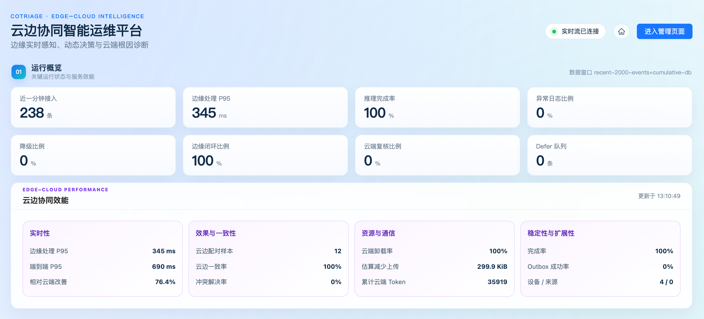

*图 9-1 CoTriage 当前运行窗口指标看板。页面完整保留实时性、效果与一致性、资源与通信、稳定性与扩展性等区域；画面同时包含近期事件窗口与累计数据库口径。*

图 9-1 说明系统已经具备统一收集和展示关键运行指标的能力。页面中的数值属于截图时刻的运行状态，不单独承担跨环境、跨时间或跨方法的结论。特别是，页面展示的 P95 与赛事关注的平均端到端时延不是同一个统计量；相对指标必须知道参照值、样本集合和计算公式后才能解释；没有发生 Outbox 重放或决策冲突时，比例显示为零也不能直接理解为成功或失败。

### 9.3 指标口径说明

| 指标方向 | 赛事口径 | 当前页面显示 | 正确阅读方式 |
| --- | --- | --- | --- |
| 运行窗口 | 明确时间范围、事件分母和去重方式 | 近期接入、推理完成与异常比例 | 说明截图时系统持续处理事件；不同卡片可能采用不同窗口 |
| 实时性 | 明确起止点，并区分平均值、P95 与 TTFT | 边缘处理 P95、端到端 P95及相对卡片 | P95 反映长尾，不替代平均值；相对卡片不在本报告中展开为独立结论 |
| 感知与一致性 | 明确标签、配对规则、样本量和冲突定义 | 云边配对、一致率与冲突处理 | 少量配对只能描述当前记录；没有冲突时，零比例没有失败或成功含义 |
| 资源与通信 | 明确统计层级、累计周期和数据边界 | 上传估算、云端 Token 与路由构成 | 反映系统具备资源观察能力；累计量需结合时间范围解释 |
| 稳定性 | 明确网络条件、任务总数和恢复阶段 | 完成率、Outbox、Defer 与降级状态 | 没有延期事件的窗口不能说明弱网补传效果，也不能说明其失败 |
| 扩展性 | 明确设备、来源和场景的业务定义 | 设备/来源状态 | 表示当前登记或观察状态，不代表可扩展上限 |

“边缘处理完成”和“云端深度诊断完成”也应分别理解。前者说明现场何时获得可用初判，后者说明关联上下文和更强模型何时返回完整结果。若把两个阶段混成一个时延，既无法体现边缘快速路径，也无法定位网络或云端服务造成的等待。

### 9.4 面向答辩的指标解释顺序

答辩时建议先说明页面的窗口与统计类型，再按照“实时性—效果与一致性—资源与通信—稳定性—扩展性”从左到右讲解。对于当前画面没有触发的冲突、延期或降级事件，只说明该窗口的状态，不推导恢复能力。这样既能够展示系统已经建立赛事指标观察面，也能保持页面数值与结论之间的边界清晰。

## 10. 创新点、应用价值、当前边界与结论

### 10.1 四项协同创新

1. **面向日志成本结构的边缘分层推理。** 规则、模板、轻量分类器和边缘小语言模型不是简单串联，而是按确定性与成本提前结束或继续升级，使常见事件快速处理、困难事件获得更多语义能力。
2. **事件价值与系统条件联合感知的三动作路由。** RAISE 同时考虑风险、不确定性、历史分歧、网络、预算和队列，通过 `DEFER` 把“值得上云”与“此刻能够上云”解耦。
3. **弱网请求的持久化和优先处理。** Outbox 将延期请求保存在数据库中，并按分数、截止时间和创建时间选择任务，使链路波动不会阻断现场初判，也不会简单丢弃仍有分析价值的事件。
4. **数据面、控制面和观测面一体化。** 统一事件、在线配置、路由解释和运行看板共同组成可操作系统，模型能力不再停留在离线脚本，而是进入可追踪的工程链路。

四项创新彼此支撑：分层推理降低常见事件的处理成本，RAISE 决定何时使用云端能力，Outbox 保存暂时无法发送的高价值请求，控制与观测面则保证每次配置和路由可以治理、解释和复盘。

### 10.2 应用价值与扩展方式

CoTriage 可面向工业生产线、能源站点、数据中心、中间件集群和其他对时延、隐私、带宽或离线能力有约束的感知任务。系统的应用价值体现在三个层次：

- **现场层：** 日志先在近端完成初筛，云端不可用时仍保留基本判断和事件追踪；
- **平台层：** 云端资源按事件价值调用，复杂事件获得上下文诊断，普通事件不必无差别上传；
- **治理层：** 规则、模型与 Provider 可在线管理，路由和延期处理保留状态与原因。

扩展新场景时，主要替换采集适配、领域规则与模板、模型和界面词汇，统一事件、三动作路由、Outbox 与管理接口可以继续复用。组件解耦也允许按日志吞吐、边缘算力或云端并发分别扩容，而不需要重写整个系统。

### 10.3 当前工程边界

| 类别 | 当前边界 | 后续工程方向 |
| --- | --- | --- |
| 消息恢复 | Router 与 Cloud Gateway 尚未自动接管旧 Pending | 增加 XAUTOCLAIM 或等价机制，验证重复与恢复语义 |
| 弱网闭环 | replayer 未以云健康门控，发送与云端完成状态未完全分离 | 增加健康触发、独立完成确认和恢复过程观察 |
| 自适应反馈 | 两阶段 Reward 语义不同，GainModel 预测值尚未直接进入决策 | 统一反馈定义，以可解释、可回滚方式接入路由 |
| 安全保护 | 当前重点脱敏原始日志，其他提示字段仍需扩展 | 建立字段级脱敏、专用密钥托管、权限与审计机制 |
| 模型能力 | MiniLM 当前主要完成日志告警二分类 | 扩展任务范围，并保持模型版本与任务定义清晰 |
| 指标解释 | 运行看板混合近期窗口与累计口径，部分比例在零分母下语义有限 | 统一窗口、分母和计时边界，为关键卡片增加 N/A 语义 |

这些边界集中在恢复语义、自适应接线、安全落地和统计口径，不改变系统已经形成的功能主线。把边界写清楚，可以避免把“已保存请求”误说成“已完成诊断”，也避免把页面快照误说成跨场景结论。

### 10.4 结论

CoTriage 已将多节点日志采集、统一事件化、边缘分层推理、RAISE 动态路由、Outbox 延期请求、云端结构化诊断、在线配置和 Web 运行观察组织为一条连贯的工程链路。现场人员可以从实时驾驶舱发现事件，从推理路径理解边缘判断，从路由状态理解云边选择，再进入云端诊断查看根因和处置建议；管理员则可以在同一系统中维护规则、模型和 Provider。

作品的核心价值不在于让边缘完全替代云端，也不在于把所有事件交给更大的模型，而在于根据事件风险和运行条件分配分析能力。确定性高的事件快速留在现场，高价值复杂事件按需获得云端上下文，暂时不能发送的请求持久化等待处理。当前系统已经能够完整展示这套协同机制如何运行、如何配置和如何被观察，同时也明确保留消息恢复、反馈接线、安全与指标口径方面的工程边界。

## 附录 A：RAISE 方法定义与关键算法细节

### A.1 事件分数

对于事件 \(e_t\) 和系统状态 \(s_t\)，RAISE 的总体评分形式为：

\[
S_t = \beta_v V(e_t) + \beta_g G(e_t) - \beta_k K(e_t,s_t)
\]

其中：

- \(V(e_t)\) 表示事件价值，由严重度、校准不确定性、模板新颖度、历史边云分歧、影响设备范围和推理路径风险构成；
- \(G(e_t)\) 表示云端可能带来的纠错或新增信息收益，并包含适度探索项；
- \(K(e_t,s_t)\) 表示调用成本，由预计时延、网络压力、云端队列、预算和隐私代价等构成。

各特征在进入组合前进行归一化和裁剪，权重由配置管理。直观上，严重、新颖或边缘判断不稳定的事件会提高分析价值；网络拥塞、预算紧张或隐私风险会提高成本。

### A.2 动态门槛

RAISE 使用随系统状态变化的路由门槛：

\[
\Theta_t = \Theta_0 + \alpha_q Q_t + \alpha_b B_t + \alpha_n N_t - \alpha_a A_t
\]

其中，\(Q_t\) 表示云队列与 Outbox 压力，\(B_t\) 表示预算压力，\(N_t\) 表示网络压力，\(A_t\) 表示审计采样不足程度。系统压力上升时门槛提高，把云端资源留给更高价值事件；近期缺少云端审计样本时门槛适度降低，保留必要的探索。

单条事件分数与全局动态门槛比较后，才形成路由意图。这样可以避免仅凭一次模型置信度决定所有上云行为，也能让同一类事件在不同网络和预算状态下采用不同动作。

### A.3 硬策略优先级

硬策略位于软评分之前：

1. 命中 `deny-cloud` 或 `force-local` 时选择 `LOCAL`；
2. 命中 `force-cloud` 时形成上云意图，但仍需处理网络、限流和预算条件；
3. 一般事件先计算分数与动态门槛；
4. 分数未达到门槛时选择 `LOCAL`；
5. 分数达到门槛且发送条件允许时选择 `CLOUD`；
6. 分数达到门槛但当前发送条件不满足时选择 `DEFER`。

硬约束保证隐私和生产策略不会被在线分数覆盖，软评分则在允许范围内优化云端资源分配。

### A.4 决策流程伪代码

```text
输入：边缘推理事件 e，网络/队列/预算状态 s，运维策略 p

if p 禁止事件上云 or p 强制本地:
    return LOCAL, policy_reason

提取风险、不确定性、新颖度、历史分歧和影响范围
估计云端增益、探索项以及网络/预算/隐私成本
score = event_value + expected_gain - system_cost
threshold = base_threshold + pressure_adjustments - audit_adjustment

if score < threshold:
    return LOCAL, score_and_threshold

if 云端健康 and 限流允许 and 预算允许:
    return CLOUD, score_and_state

return DEFER, score_and_blocking_condition
```

每次决策保存动作、原因、分数、门槛、特征与状态快照，以支持页面解释和事后追踪。

### A.5 在线反馈的当前语义

Cloud Gateway 会生成包含纠错、新增建议、高风险确认、时延和 Token 代价的复合 Reward；Router 在更新在线状态时又依据首个匹配条件将其映射为离散值。当前实际更新使用 Router 的离散语义，GainModel 可以训练和保存，但其预测值尚未直接进入 `Decide` 的预期收益。历史纠错统计和 UCB 探索仍会间接影响路由。

因此，反馈链路已经具备记录、统计和状态恢复的工程基础，决策侧仍需统一 Reward 定义并完成 learned gain 接线。该说明用于界定当前算法与工程实现，不改变 RAISE 的三动作路由主流程。

## 附录 B：赛事指标术语与计算口径

### B.1 时延指标

- **边缘处理时延：** 从事件进入边缘推理阶段到边缘结果产生的时间，需明确是否包含排队与模型服务调用。
- **首次有效边缘决策时延：** 从事件进入系统到现场获得可用边缘判断的时间。
- **端到端时延：** 必须明确终点是边缘判断、路由完成还是云端完整诊断；不同终点不能使用同一名称。
- **TTFT（Time to First Token）：** 云端请求发出后，到模型开始返回首个 Token 的等待时间，不等于完整响应时延。
- **平均值：** 描述样本总体水平，容易受到极端值影响。
- **P95：** 95% 样本不超过的时延位置，用于观察长尾体验，不能替代平均值。

所有时延都需要明确起点、终点、是否包含排队、统计窗口和样本量。页面中的单事件时延适合排查具体事件，窗口分位数适合观察运行状态，两者作用不同。

### B.2 稳定性与一致性

```text
基本业务功能保持率
= 弱网期间产生本地有效判断的事件数 / 弱网期间事件总数

冲突率
= 关联任务中出现不一致决策的任务数 / 关联任务总数

冲突解决成功率
= 最终被统一或正确纠正的冲突数 / 实际发生的冲突总数
```

如果弱网窗口没有事件，业务功能保持率没有可解释分母；如果没有发生冲突，冲突解决成功率也没有可解释分母。此类情况应显示为 N/A 或明确说明“本窗口未发生相应事件”，不应把零值解释为成功或失败。

### B.3 资源、通信与扩展性

- **进程资源：** 记录模型加载前后和稳态运行时的 CPU、内存与模型文件大小，避免把不同层级的资源值混在一起。
- **上传量：** 明确统计的是原始日志、结构化事件、裁剪上下文还是完整请求体。
- **Token 用量：** 区分单次请求、当前窗口和累计数据库记录，并说明 Provider 的计数方式。
- **设备与来源：** 表示当前系统登记或观察到的对象；节点数、日志类型和应用场景需要分别定义。
- **完整性：** 关注采集、推理、路由、诊断、配置和展示是否形成可操作闭环，不等同于页面数量。

### B.4 当前指标看板的使用原则

1. 保留页面完整上下文，不单独放大某个相对百分比形成结论；
2. 同时说明指标的窗口、分母、样本量和计时边界；
3. 区分近期事件窗口与累计数据库口径；
4. 对未触发的冲突、延期、重放和降级状态使用中性描述；
5. 不用 P95 替代平均时延，不用 TTFT 替代完整诊断时延；
6. 不用设备登记数量推断系统的扩展上限。

## 参考文献

1. 山东浪潮数据库技术有限公司. 面向云边协同场景的分布式人工智能感知与决策关键技术研究：比赛方案（题目编号 XH-202606）, 2026.
2. Zhu J, He S, He P, Liu J, Lyu M R. Loghub: A Large Collection of System Log Datasets for AI-driven Log Analytics. ISSRE, 2023.
