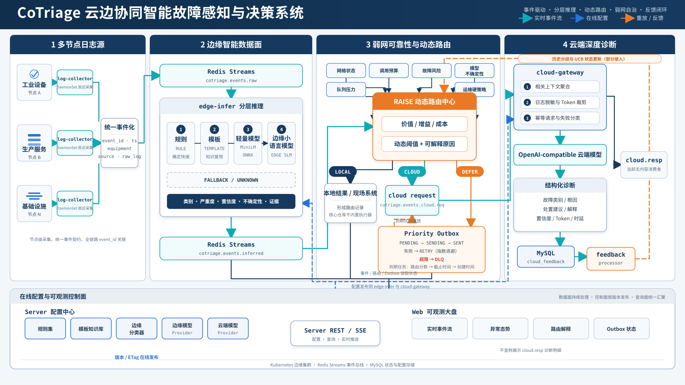

# CoTriage 系统设计说明书

| 项目 | 内容 |
| --- | --- |
| 文档版本 | V0.1（正文初稿） |
| 事实核对日期 | 2026-07-30 |
| 适用代码基线 | `feature/submission-materials`，`966aaffe62b4` |
| 状态 | 当前实现设计已静态核对；架构运行证据与性能结论待补 |

## 1. 设计目标与边界

CoTriage 面向工业设备、基础软件和边缘节点持续产生的日志流，解决固定规则覆盖有限与全量上云成本过高之间的矛盾。系统把低成本、低时延的判断放在边缘侧，将更复杂且具有上云价值的事件按需送往云端，并在弱网或云端不可用时保持边缘基本决策和后续补偿能力。

本系统的“边缘”指工厂、车间、园区或站点近端的 Kubernetes 边缘集群，不等同于一台终端设备。当前实现处理的最小 Event 是一条新增日志行；设计文档中关于窗口聚合的构想尚未体现在当前 `log-collector` 代码中。

核心设计目标如下：

1. 多工作节点日志就近接入，形成可追踪的统一事件；
2. 通过规则、模板、轻量分类器和边缘小语言模型完成四级推理；分类器未配置或调用报错时进入 `FALLBACK`，边缘 LLM 缺失或失败时保留分类器结果并记录错误；
3. 根据事件价值、系统成本、网络、预算和运维意图动态选择 `LOCAL/CLOUD/DEFER`；
4. 在初始上云条件不满足时保留边缘判断，并用 Outbox 持久化请求、周期重放到期记录；
5. 利用云端诊断结果形成反馈，更新路由所需的历史统计；
6. 通过 Server 与 Web 提供统一配置、查询及边缘推理/路由展示；云端诊断结果的查询和页面展示当前尚未接入。

模型准确率、时延、资源、弱网保持率和一致性不属于架构代码可直接证明的事实，分别由 `EVID-EXP-QUALITY-01`、`EVID-EXP-LATENCY-01`、`EVID-EXP-MEMORY-01`、`EVID-EXP-WEAKNET-01` 和 `EVID-EXP-CONSISTENCY-01` 验证。

## 2. 设计原则

- **边缘快速路径优先：** 确定性强的日志优先由规则和模板处理，减少不必要的模型调用。
- **推理与路由解耦：** `edge-infer` 只产出结构化判断，`router-controller` 独立决定是否上云。
- **风险与成本联合决策：** 上云价值不仅由置信度决定，还考虑严重度、新颖度、历史分歧、影响范围、网络和预算。
- **动作与可发送性分离：** `DEFER` 表示“值得上云但当前不可发送”，避免把网络故障错误解释为事件没有上云价值。
- **事件驱动与可追踪：** `event_id` 贯穿采集、推理、路由、Outbox 和云端反馈。
- **成功后确认：** 消费者在关键结果发布或持久化成功后才 ACK；不可恢复消息进入 DLQ。
- **配置发布与执行分离：** Server 管理配置，`edge-infer` 通过 ETag 轮询拉取并在内存中替换。
- **事实与结果分离：** 代码结构、配置默认值和算法公式是设计事实，不等同于实测效果。

## 3. 总体架构



图中实线青色箭头表示在线事件流，海军蓝虚线表示配置与控制，橙色虚线表示延迟重放或反馈。`LOCAL` 仅形成路由记录并供外部现场系统消费，当前核心仓库不内置执行器；`DEFER` 由 Outbox replayer 周期选择到期记录后重投云端请求流，并非由网络恢复信号直接触发；云端反馈已更新历史分歧等状态，但 learned gain 尚未直接进入路由分数，因此标记为“部分接入”。

架构静态追溯对应 `【证据：EVID-ARCH-01】`，运行态页面和截图对应 `【待证据：EVID-UI-01】`。

## 4. 组件设计

### 4.1 `log-collector`

`log-collector` 当前以 Go 进程实现，Kubernetes 清单使用 DaemonSet 部署在非控制面工作节点。它从配置的日志文件末尾开始读取后续新增行，为每行生成 UUID 类型 `event_id`，补充 UTC 时间和设备标识，再写入 `cotriage.events.raw`。

设备标识优先读取所在 Node 的 `cotriage.io/equipment` 标签；读取失败时回退到显式配置或主机名。采集器使用近似 `MAXLEN` 控制 Stream 长度。当前限制是只跟随已打开文件，不处理日志轮转或 inode 替换。

### 4.2 `edge-infer`

`edge-infer` 消费原始事件并按从快到慢的顺序执行：

1. 校验 `event_id` 与原始日志，规范化日志并计算稳定 `template_id`；
2. 匹配内置或远程发布的规则；
3. 查询配置模板及按规则版本隔离的 Redis 模板缓存；
4. 如配置了 HTTP 分类器，执行 MiniLM ONNX `NON_ALERT/ALERT` 二分类；
5. 当分类器输出异常且边缘小语言模型可用时，执行细粒度诊断；
6. 分类器未配置或调用报错时进入 `FALLBACK/UNKNOWN`；若分类器已成功输出而边缘 LLM 缺失或失败，则保留 `MODEL` 结果并追加 `edge_llm_error`，不伪造 LLM 结论。

输出包含类别、严重度、置信度、不确定性、模板、证据、建议、推理路径、模型/规则版本及阶段时延。高置信且非未知的结果可写入带 TTL 的模板缓存；缓存读写失败只记录证据，不阻断主推理结果。

远程配置同步使用 `GET /api/v1/edge-config` 与 ETag。收到新配置后先完成规则、模板、分类器和边缘 Provider 的解析校验，再依次调用 `UpdateKnowledge` 与 `UpdateModels` 更新知识配置和模型配置；这两次更新各自受锁保护，但不是跨知识与模型子系统的整体原子替换。获取或解析失败时不进入这两次更新，保留上一份可用配置。

### 4.3 `router-controller`

`router-controller` 消费 `cotriage.events.inferred`，从边缘结果、在线历史和运行状态构造 RAISE 输入。它负责：

- 计算特征、成本、压力、动态门槛与动作；
- 将轻量展示字段持久化到 `router_decisions`；
- 将所有动作发布到 `cotriage.events.routed`；
- 对 `CLOUD` 发布云端请求；
- 对 `DEFER` 创建幂等 Outbox 记录；
- 周期选择到期 Outbox 记录并尝试发布到云端请求流；
- 从 MySQL 查询未处理的 `cloud_feedback`，更新内存状态并保存快照；该处理器不消费 `cloud.resp` Stream。

当前主进程启动主 Worker、Outbox replayer 和 feedback processor，共享同一个内存状态管理器。部署清单为单副本；多副本运行需要额外协调在线状态。

### 4.4 `cloud-gateway`

`cloud-gateway` 消费 `cotriage.events.cloud.req`，从近期 inferred 事件中按时间、模板、来源、设备、类别和严重度选择上下文，并按事件数、字符数和 Token 预算裁剪。随后调用 OpenAI-compatible Chat Completions 接口，解析结构化诊断结果，生成根因、建议、解释、置信度、使用量和反馈信号。

反馈先幂等写入 `cloud_feedback`，再发布到 `cotriage.events.cloud.resp`。如果数据库已成功而响应发布失败，重试会读取已保存的 `feedback_json` 再发布，避免重复云端调用。无法恢复的格式或 Provider 错误进入 DLQ。当前核心链路没有消费该响应 Stream 的内容：Server 只读取 Stream 长度用于统计，Router 的反馈处理器直接查询 MySQL。

### 4.5 `server`

Server 是控制面和查询面，不是云端推理执行者。它通过 Gin 注册 REST/SSE 路由，从 Kubernetes 查询工作节点与采集器状态，从 Redis 聚合实时事件，从 MySQL 查询路由/Outbox/配置，并提供规则、模板及 Provider 的管理接口。

Server 启动时可执行 GORM schema 迁移，并幂等写入内置常用规则；配置发布通过版本与 ETag 支持 `edge-infer` 和 `cloud-gateway` 热更新。

### 4.6 `web`

Web 使用 Vue 3、Vite、Ant Design Vue 和 ECharts，提供首页、分诊大盘、设备管理、规则管理、模板知识库和模型管理。实时边缘事件与路由使用 SSE，统计和配置使用 REST API。当前页面不查询或展示云端根因、建议和置信度。数字人页面属于可选 PoC，不影响核心链路。

## 5. 消息拓扑与数据契约

### 5.1 Redis Streams

| Stream | 当前写入者 | 当前读取者/用途 | 核心内容 |
| --- | --- | --- | --- |
| `cotriage.events.raw` | `log-collector` | `edge-infer-g` | 单条原始日志事件 |
| `cotriage.events.inferred` | `edge-infer` | `router-g`；Server/Cloud Gateway 读取快照或上下文 | 结构化边缘推理结果 |
| `cotriage.events.routed` | `router-controller` | Server 路由 SSE/展示 | RAISE 动作、特征、成本、压力和系统态 |
| `cotriage.events.cloud.req` | `router-controller`、Outbox replayer | `cloud-gateway-g` | 上云请求、幂等键和路由负载 |
| `cotriage.events.cloud.resp` | `cloud-gateway` | Server 仅用 `XLEN` 统计；当前无内容消费者 | 结构化云端诊断与反馈，供后续查询/展示集成 |
| `cotriage.events.dlq` | 多个处理阶段 | Server 大盘与人工排障 | 不可恢复消息及错误信息 |

Stream 名称均可通过环境变量调整；跨组件修改时必须保持生产者和消费者一致。

### 5.2 原始事件

当前原始事件的核心字段为：

| 字段 | 含义 |
| --- | --- |
| `event_id` | 全链路唯一标识 |
| `ts` | 采集时间，UTC RFC3339Nano |
| `equipment` | Node 标签、显式配置或主机名得到的设备标识 |
| `log.raw` | 一条新增日志行 |
| `source` | 可选来源字段；当前采集器载荷未强制写入 |

### 5.3 边缘推理事件

推理事件保留 `event_id`、来源、设备、事件时间和脱敏前需谨慎处理的日志摘要，并新增：

- `template_id`、`template_text`；
- `edge_pred`、`severity`、`confidence`、`uncertainty`；
- `evidence`、`advice_code`、`advice`；
- `inference_path`、`model_version`、`rule_version`；
- 总时延与规范化、缓存、模型、边缘小语言模型、发布等阶段时延。

### 5.4 路由与云端事件

路由事件使用嵌套结构保存原始 inferred 输入、RAISE 决策、系统状态、路由时间、路由器标识和 schema version。云端请求额外包含 `request_id`、`idempotency_key`、`payload_json` 与路由决策信息。

云端响应包含 `event_id`、`request_id`、幂等键、状态、边缘摘要、云端诊断、反馈、Token/时延等使用量、上下文摘要和错误字段。当前发布该结构后没有核心内容消费者，Web 也不展示其中的根因、建议或置信度，因此“响应已发布”不能表述为“用户已看到诊断”。所有后续外部发布或展示必须对原始日志、上下文和错误消息执行脱敏复核。

数据契约与全链路对应关系：`【证据：EVID-ARCH-01】`。

## 6. RAISE 路由方法

RAISE 的英文全称为 Risk-Aware, Uncertainty-Calibrated, Intent-Constrained, Self-Adaptive Edge-Cloud Routing。当前代码把路由建模为价值、配置公式计算的预期收益、系统成本和动态约束共同作用的在线决策；反馈自适应接线尚未完整贯通。

### 6.1 特征与成本

云端价值由以下归一化特征加权得到：

- 风险：由严重度映射；
- 校准不确定性：结合温度缩放后的置信度和保序集合大小；
- 模板新颖度：模板历史频率越低，新颖度越高；
- 历史分歧：云端纠正边缘结果的后验统计；
- 设备影响范围：相关设备数量的归一化值；
- 推理路径风险：规则、缓存、模型、边缘小语言模型和降级路径具有不同风险先验。

系统成本由云调用、估计时延、网络和隐私成本组成；运行压力由队列、预算、网络和最低审计比例组成。

### 6.2 评分与动态门槛

实现中的抽象形式为：

```text
score = clamp(w_value * cloud_value
            + w_gain  * expected_gain
            - w_cost  * total_cost)

threshold = clamp(base
                + k_queue   * queue_pressure
                + k_budget  * budget_pressure
                + k_network * network_pressure
                - k_audit   * audit_pressure)
```

这里的默认权重是运行配置，不是训练或实测结论。任何参数对最终指标的影响都必须通过主实验、消融或敏感性分析验证。

### 6.3 策略约束与动作规则

动作选择先执行运维策略硬约束：禁止上云或强制本地直接得到 `LOCAL`；强制上云在当前可发送时为 `CLOUD`，不可发送时为 `DEFER`。无硬约束时，评分低于动态门槛选择 `LOCAL`；否则根据可发送性选择 `CLOUD` 或 `DEFER`。

“可发送”要求云端健康、速率额度和分钟/日预算可用，且失败率不超过配置限制。队列和预算也会抬高动态门槛。这样可以将“事件是否值得上云”与“现在是否能上云”分开表示。

### 6.4 在线反馈

云端反馈按当前实现存在两阶段 Reward 语义。第一阶段由 Cloud Gateway 计算连续值：

\[
r_{gateway}=\operatorname{clip}_{[-1,1]}(0.35D+0.30A+0.20H+0.15\Delta c-0.10L-0.05T)
\]

其中，\(D\) 表示云端类别不为 `UNKNOWN` 且与边缘类别不一致，\(A\) 表示同时存在非空根因与建议，\(H\) 表示边缘严重度不低于 75 且云端置信度不低于 0.65，\(\Delta c=\max(0,c_{cloud}-c_{edge})\)，\(L\) 和 \(T\) 分别是按时延 SLA 与 Token 预算截断到 1 的归一化成本。Cloud Gateway 将该连续值及原因写入 `cloud_feedback` 和响应载荷。

第二阶段由 Router feedback processor 从 MySQL 查询未处理记录并调用 `ClassifyReward`，按首个匹配条件重新分类：边缘被纠正或两侧非空类别不同为 `1.0`；存在可执行信息标志、非空根因或非空建议为 `0.7`；确认高风险为 `0.3`；其余为 `0.0`。processor 将这个离散值传给 `ApplyFeedback` 更新在线状态，随后 `FinalizeFeedbackReward` 覆盖数据库中的 `reward` 与 `reward_reason`，并保存状态快照；它不消费 `cloud.resp` Stream。

因此，当前在线状态实际使用 Router 的离散 Reward，数据库最终列也保留离散值，而不是 Gateway 最初的连续效用值。两阶段定义及覆盖行为属于实现语义不一致和待统一项；实验与审计应分别保存 Gateway 响应载荷、处理前数据库值、处理后数据库值和状态快照。任何一套 Reward 都只是内部更新信号，不是准确率或业务收益的直接测量值。

`ApplyFeedback` 会更新模板纠错统计与 `GainModel` 的参数和快照；但 `BuildStats` 调用 `GainModel.Predict` 后丢弃 learned gain，只把 bonus 放入统计，`Decide` 的 `expectedGain` 仍由固定偏置、校准不确定性、历史分歧、模板新颖度和 UCB 公式计算。因此反馈目前只通过纠错率形成的历史分歧和 UCB 探索间接影响路由，学习到的 gain 尚未直接进入决策分数。

RAISE 路由、系统态和反馈静态实现：`【证据：EVID-RAISE-01】`；实际界面联动：`【待证据：EVID-UI-01】`。

## 7. 弱网自治与 Outbox

当 RAISE 输出 `DEFER` 时，`router-controller` 以 `event_id`、`request_id` 和幂等键创建 Outbox，记录载荷、路由决策、优先级、推迟原因、尝试次数、截止时间和状态。

数据模型声明了 `PENDING`、`SENDING`、`SENT`、`DONE`、`RETRY`、`DLQ`，但当前 replayer 的活动状态流是：

```text
PENDING / RETRY --到期且加锁成功--> SENDING --Redis XADD 成功--> SENT
                                           \--发布失败且未达上限--> RETRY
                                            \-发布失败且达到上限--> DLQ
过期的 SENDING -----------------------------------------------> RETRY
```

`MarkOutboxSent` 将状态写为 `SENT` 时同时写入 `sent_at` 和 `done_at`；当前没有独立的 `SENT -> DONE` 云端确认转换。因此 `SENT` 或非空 `done_at` 只证明 replayer 已成功向 Redis 请求流执行 `XADD`，不证明 cloud-gateway、外部模型或页面展示已经完成。

replayer 只选择到期且未被有效锁定的 `PENDING/RETRY` 记录，排序依据依次为持久化的 `priority_score DESC`、`deadline_at ASC`（无截止时间的记录排在有截止时间之后）和 `created_at ASC`。`priority_score` 在创建 Outbox 时取原始 RAISE `decision.Score`；replayer 不再按严重度、不确定性、预期收益、等待时间或强制上云策略动态重算优先级。

replayer 没有网络恢复、云健康、预算或速率限制门控。它按周期与 `next_retry_at` 尝试 Redis 发布，失败时指数退避，达到次数上限后转入 `DLQ`。因此“网络恢复后补传”只能作为实验中对网络条件与队列变化的关联观察，不能写成当前实现的显式触发机制。

弱网期间边缘规则、模板、分类器和可用的边缘小语言模型仍可输出本地判断，但“基本业务功能保持率”、Outbox 请求发布成功率和下游云端完成率必须以实验定义及数据证明，不能由机制设计直接推出。

弱网与恢复证据：`【待证据：EVID-EXP-WEAKNET-01】`。

## 8. 控制面接口

当前 `server/internal/api/router.go` 注册的接口如下。

| 接口组 | 路由 | 用途 |
| --- | --- | --- |
| 设备 | `GET /api/v1/devices` | 查询工作节点、设备和采集状态 |
| 大盘 | `GET /api/v1/dashboard/summary`、`/timeseries`、`/abnormal-analysis` | 汇总、趋势和异常聚合 |
| 事件 | `GET /api/v1/events`、`GET /api/v1/events/stream` | 事件列表与 SSE |
| Router | `GET /api/v1/router/summary`、`/decisions`、`/decisions/:event_id`、`/outbox`、`/state`、`/stream` | 路由统计、记录、Outbox、状态和 SSE |
| 边缘 Provider | `POST/PATCH/GET/DELETE /api/v1/edge-providers...`、`POST .../:id/activate` | 边缘小语言模型配置 |
| 分类器 | `POST/PATCH/GET/DELETE /api/v1/edge-classifiers...`、`POST .../:id/activate` | HTTP 轻量分类器配置 |
| 规则 | `POST/PATCH/GET/DELETE /api/v1/edge-rules...`、规则集创建与激活 | 规则与规则集管理 |
| 模板 | `POST/PATCH/GET/DELETE /api/v1/edge-templates...`、`POST /from-cluster`、模板集创建与激活 | 模板知识与模板集管理 |
| 边缘配置 | `GET /api/v1/edge-config` | 向 `edge-infer` 发布组合配置，支持 ETag |
| 云端 Provider | `POST/PATCH/GET/DELETE /api/v1/cloud-providers...`、`POST .../:id/activate` | 云端模型配置 |
| 云端配置 | `GET /api/v1/cloud-config` | 向 `cloud-gateway` 发布激活配置，支持 ETag |

接口参数、响应结构和错误状态应以当前 handler 与 model 为准。本文不为尚未注册的设计接口提供“已实现”声明。

## 9. 持久化设计

| 数据 | 主要载体 | 设计目的 |
| --- | --- | --- |
| 实时事件与阶段结果 | Redis Streams | 解耦组件、支持消费者组与实时展示 |
| 模板缓存、幂等与重试辅助状态 | Redis | 低时延访问；可能随开发环境清理而丢失 |
| 路由决策 | MySQL `router_decisions` | 大盘查询和轻量审计 |
| 路由状态 | MySQL `router_state_snapshots` | 保存反馈和系统态快照 |
| 待重放请求 | MySQL `cloud_outbox` | 到期发布、锁、重试与 DLQ 状态；不提供网络恢复门控 |
| 云端反馈 | MySQL `cloud_feedback` | 保存诊断、使用量、Reward 和处理状态 |
| 规则、模板和模型配置 | MySQL 配置表 | 草稿、发布、激活、版本和 ETag 管理 |

MySQL 清单包含 PVC；Redis 清单配置了 AOF 与 RDB，但当前 Redis Deployment 清单未挂载对应 PVC。实际持久化级别和故障恢复能力必须按部署环境验证。

## 10. 可靠性设计与当前边界

- `edge-infer` 使用 Consumer Group、Pending 自动接管、最大尝试次数、短期幂等键、成功后 ACK 和 DLQ；Redis 不可用时退避重连，并周期裁剪 Stream。
- `router-controller` 在决策持久化、对应输出和状态更新后 ACK；无效输入写 DLQ；当前主 Worker 未实现与 `edge-infer` 等价的 Pending 自动接管。
- Outbox 通过唯一键、任务锁、锁过期恢复、指数退避和最大次数降低重复与丢失风险。
- `cloud-gateway` 在反馈持久化和响应发布完成后 ACK，并能复用已保存反馈补发响应；当前 Worker 未实现 Pending 自动接管。
- Server 的 Router 查询具有降级保护，路由表尚未建立时返回空数据并标记 degraded，而不是使整个服务崩溃。
- 当前系统不应宣称“零丢失”或“强一致”；故障窗口、重试边界和重复处理情况需通过故障注入和长稳实验评估。

## 11. 安全与隐私设计

当前已有的安全措施包括：原始日志默认在边缘域处理、只对选择的事件聚合上云上下文、在构造云端 Prompt 时仅对主事件 `raw_log` 和关联事件 `raw_log` 中的 IPv4、邮箱、password/token/key 形式字段及长十六进制串进行正则替换、Kubernetes Secret 可用于注入基础设施密码，以及配置接口使用 `Cache-Control: no-store` 和版本标识。模板、来源、设备、证据、建议及其他非 `raw_log` 字段不在同一正则覆盖范围内，仍须在上云和展示前单独复核。

当前必须如实披露的风险包括：

1. Server 的 Gin 路由注册未体现认证与授权中间件；
2. 云端 Provider 当前数据模型和控制面路径仍包含真实 API Key 字段，属于 Demo 级实现；
3. 日志、上下文、错误信息和 SSE 可能包含业务敏感内容；
4. Redis 配置面向开发集群，不能直接等同生产安全配置；
5. 根启动脚本会执行 Redis `FLUSHDB`；
6. 运行文档和前端默认值中可能出现环境地址，公开发布前必须扫描与替换。

生产化前至少需要：统一身份认证与权限模型、TLS、凭据外置和轮换、响应字段脱敏、网络策略、审计日志、数据库最小权限、Redis 访问控制、备份恢复演练和自动化敏感信息扫描。

当前操作与安全边界的静态依据归入 `【证据：EVID-OPS-01】`；发布前的动态安全检查仍须单独完成并附在交付记录中。

## 12. 可扩展性与限制

- 新设备可通过工作节点和标签纳入采集，但 DaemonSet、RBAC 与日志路径需要匹配目标环境；
- 规则、模板和模型接口支持替换领域知识与推理后端；
- Redis Streams 可解耦阶段，但容量、消费者组和裁剪策略需要随吞吐调整；
- `edge-infer` 可按消费者组扩展，Router 当前在线状态仍按单副本思路实现；
- 当前日志事件是一行日志，跨行、堆栈和时间窗口关联需要后续数据契约演进；
- Server 当前设备速率统计会扫描近期事件，规模扩大后需要专门指标存储或预聚合；
- 多 Provider 自动切换、完整调用审计、Prometheus 指标和全链路追踪仍是后续增强方向。

## 13. 事实来源与追溯

- 总体需求：`README.md`、`design_doc/main.md`；
- 采集：`log-collector/main.go`、`charts/log-collector/`；
- 边缘推理：`edge-infer/cmd/edge-infer/main.go`、`edge-infer/internal/infer/`、`edge-infer/internal/worker/`；
- RAISE、Outbox 和反馈：`router-controller/internal/raise/`、`runtime/`、`replayer/`、`feedback/`；
- 云端诊断：`cloud-gateway/internal/`；
- API 与持久化：`server/internal/api/router.go`、`server/internal/store/`；
- Web：`web/src/router/`、`web/src/views/`、`web/src/api/`；
- 历史开发边界：`progress_doc/`，仅用于核对，不替代当前代码。
